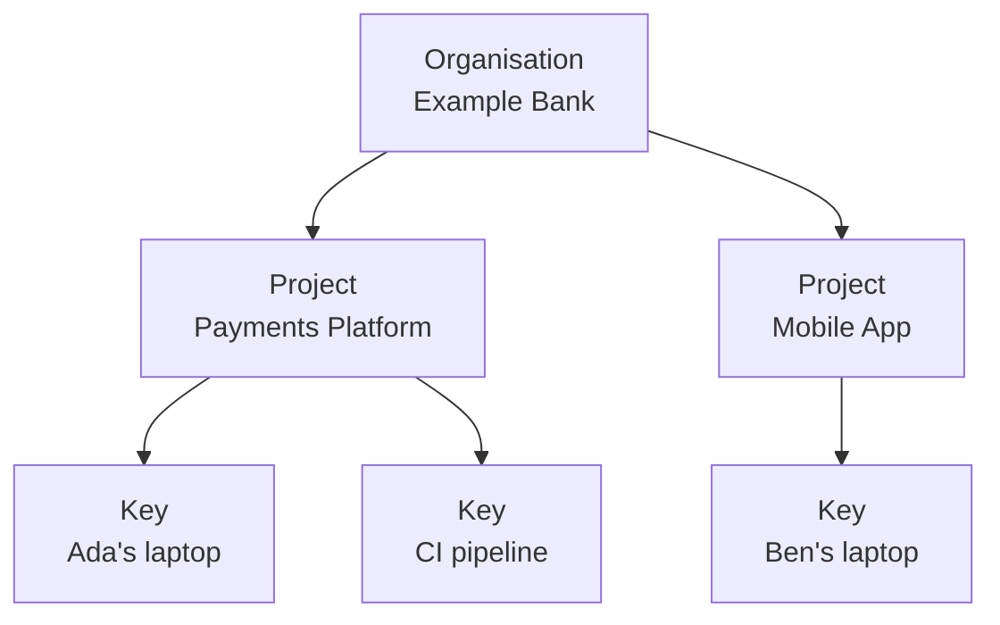

# Key concepts

## Organisations, projects and keys

Keera has three levels:

- An **organisation** is one company or customer. It has its own people,
  models, keys and settings. Nothing is shared between organisations.
- A **project** groups keys, usually by team or product. A new organisation
  starts with a project called `default`.
- An **API key** is what a tool sends with each request. Every key belongs to
  one project, and usually to one person. A key lasts 90 days unless you
  choose otherwise.

## Models and aliases

Tools never name a model directly. They name an **alias**, such as
`keera-speed`. An administrator decides which model is behind each alias. So
you can switch to a newer model, or move it to another server, and nobody has
to change their settings.

A model either runs inside the gateway's private network (**on-premises**) or
at a provider (**hosted**). Prompts sent to a hosted model leave that network.
Keera shows clearly which is which.

## Guardrails

A **guardrail** says what an organisation, a project or a key may do: which
models it may use, its budgets and rate limits, a system prompt, filters and
MCP tools.

**A level can only narrow what it gets from above, never widen it.** If the
organisation allows three models, a project can allow two of them, but not a
fourth. See [Guardrails](../manage/guardrails.md).

## Filters and routers

- A **filter** reads a request before it is sent on. It can remove things,
  such as passwords or customer names, or stop the request. See
  [Filters](../manage/filters.md).
- A **router** is something a tool can call instead of a model. It picks the
  model for each request, for example by size or by what the request is
  about. See [Routers](../manage/routers.md).

## Roles

- A **member**, usually a developer, uses their own keys and sees their own
  requests and sessions.
- An **administrator** runs one organisation.
- An **operator** runs the gateway, and can do everything in every
  organisation.

See [Users and roles](../manage/users.md#roles).

## What Keera records

Every request is written to the **request log**: who sent it, which model
answered, how many tokens it used, what it cost, how long it took, and whether
it worked. Requests that belong to one task of a coding agent are grouped into
a **session**.

**Keera never stores prompts or answers.** Only counts, costs and outcomes are
kept.

Every change an administrator makes is written to the **audit log**.
