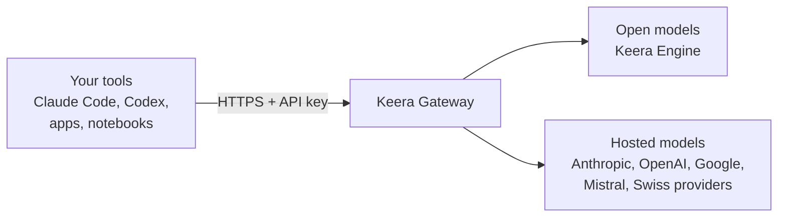

# Get started

Keera Gateway runs at <https://gateway.keera.ch>, in a Swiss cloud. Your tools
send their requests there with a key, and the gateway passes them on to a
model.

Every request goes through the same steps:

1. The gateway finds out whose key it is, and which project and organisation
   it belongs to.
2. It checks the guardrails: may this key use this model, and is there budget
   and rate limit left?
3. It runs the filters, which can remove secrets or stop the request.
4. It sends the request to the model, streams the answer back and records the
   cost.

## Next steps

- [Quickstart](quickstart.md): sign in and send a first request.
- [Key concepts](concepts.md): organisations, projects, keys, models and
  guardrails in one page.
