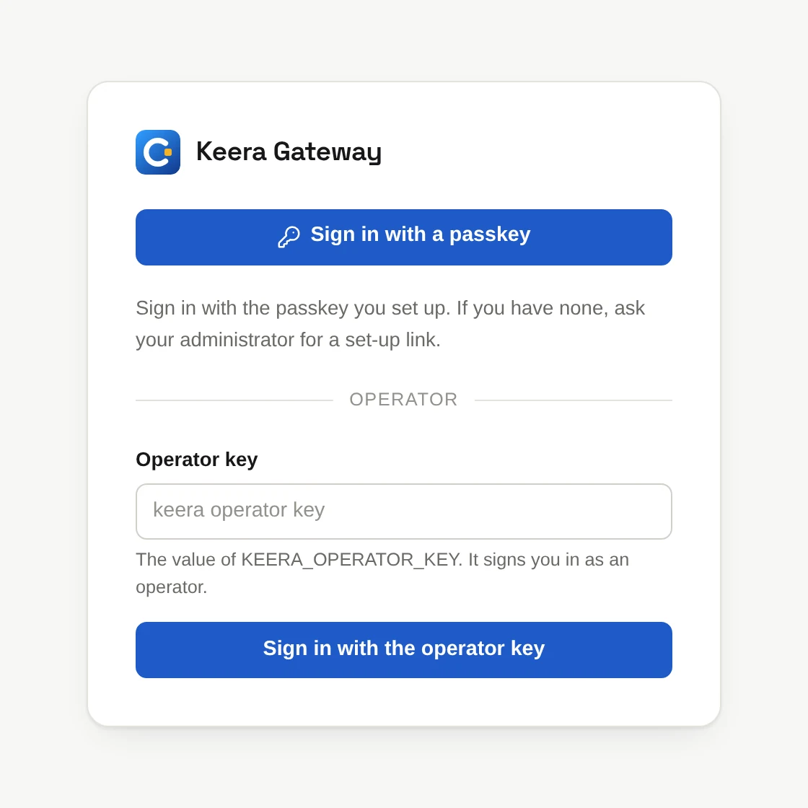
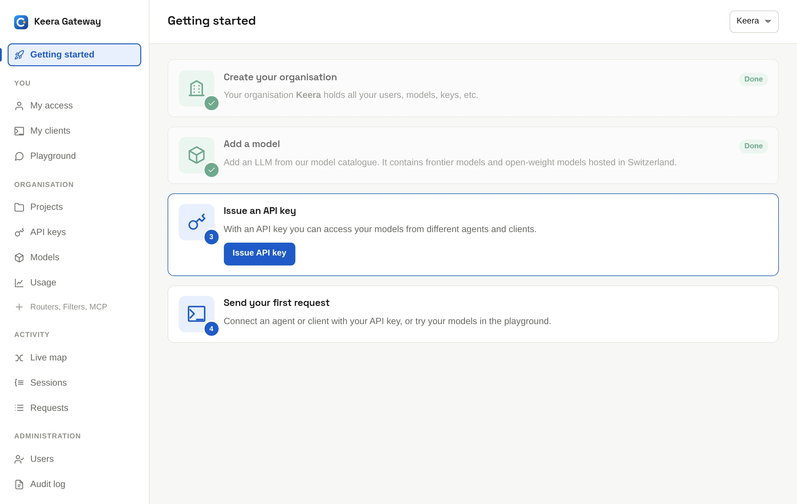

# Quickstart

Use Keera on the public instance at <https://gateway.keera.ch> and send a
first request in five minutes.

## 1. Sign in

Open <https://gateway.keera.ch> and sign in.

{ .screenshot width="420" }

The first time, you either create an organisation or join one:

- **Create organisation.** Give it a name. You become its administrator.
- **Join** your company's organisation, if an administrator added your
  address. Skip to [step 5](#5-connect-claude-code), or
  [activate your key](../use/my-access.md#activate-a-key) and go to
  [step 4](#4-send-a-request).

**Getting started** shows what is left to do.

{ .screenshot }

## 2. Add credit

A new organisation starts limited until its first payment. Open **Billing**
and click **Add credit**. You pay by card, TWINT or PostFinance Pay. See
[Billing](../manage/billing.md) and the
[prices](https://keera.ch/en/pricing).

## 3. Issue a key

Click **Issue API key**. Give the key a name, such as `my laptop`, and click
**Issue key**. Copy the secret now: it is shown only once.

## 4. Send a request

Replace `keera_sk_…` with your key:

```sh
curl https://gateway.keera.ch/api/v1/chat/completions \
  -H "Authorization: Bearer keera_sk_…" \
  -H "Content-Type: application/json" \
  -d '{"model": "keera-speed", "messages": [{"role": "user", "content": "Hello"}]}'
```

`keera-speed` is one of the models a new organisation starts with.
[My access](../use/my-access.md) lists the ones you may use, and
[Models](../manage/models.md#add-a-hosted-model) explains how to add more.
Open **Requests** to see your request in the log.

You can also try a model in the browser, in the
[Playground](../use/playground.md).

## 5. Connect Claude Code

[Install `keera`](../use/sign-in.md#in-the-terminal), then:

```sh
keera login
keera connect claude-code
```

Run `claude` in your project. For other tools, see
[Connect your tools](../use/connect.md).

## What next

- [Key concepts](concepts.md): how organisations, projects, keys and
  guardrails fit together.
- [Manage your organisation](../manage/index.md): add people, projects and
  guardrails.
