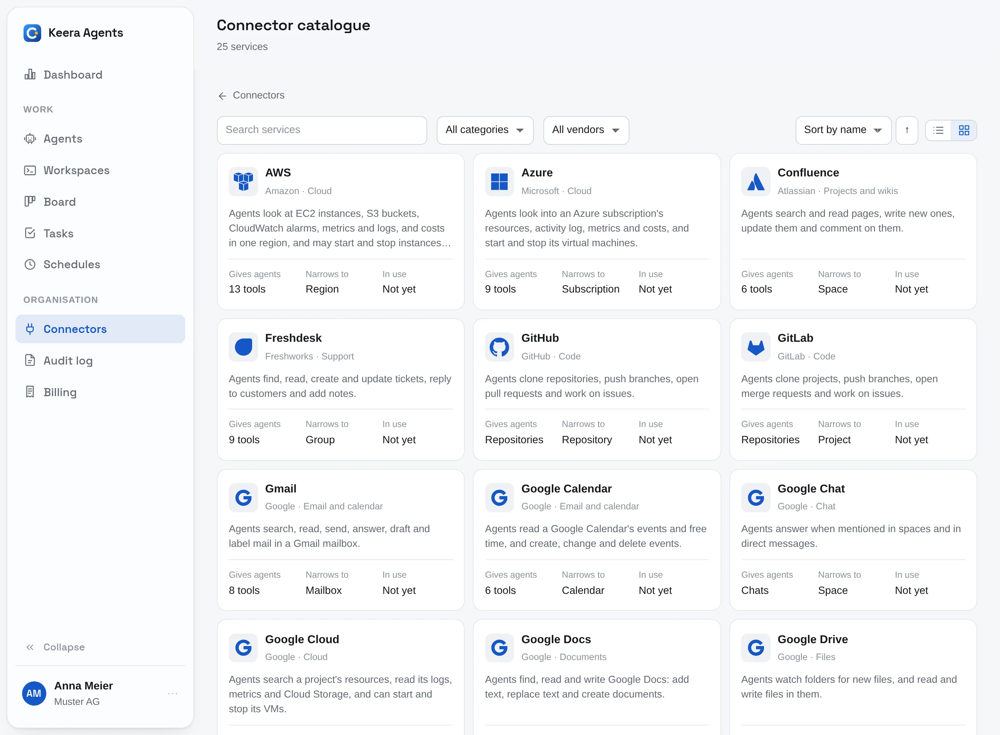
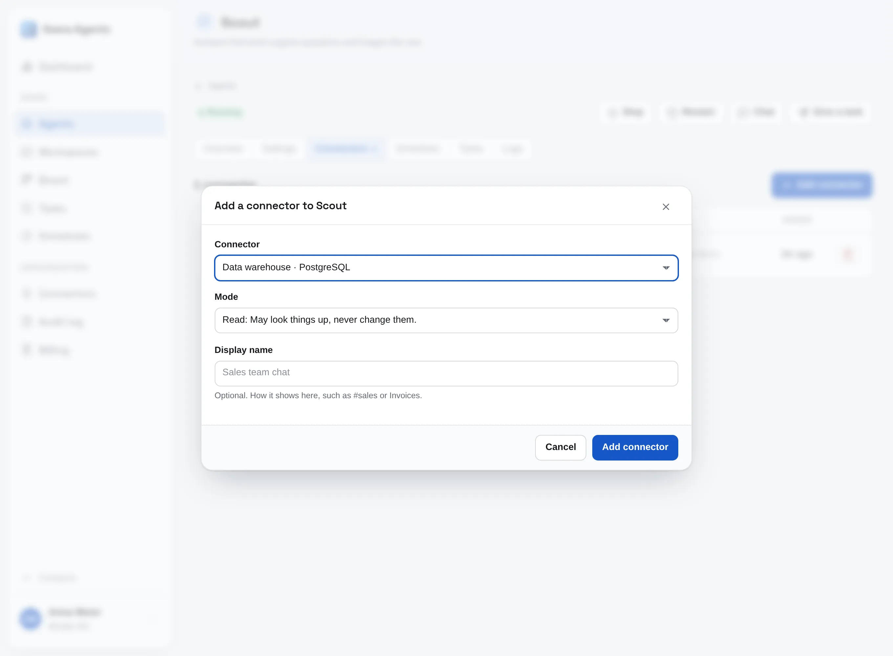

# Connectors

A **connector** holds your organisation's credentials for one service in
[Keera Agents](../use/agents.md): its Slack app, its GitHub token, its Jira
account. Agents and [workspaces](../use/workspaces.md) use it to reach that
service. Only administrators add connectors.

The credentials stay in Keera Agents, encrypted. They never reach an agent's
machine: Keera Agents makes every call for the agent, and checks that it may.

## Add a connector

In Keera Agents, open **Connectors**, click **Add connector** and pick a
service from the catalogue. The form shows the setup steps for that service.
Keera Agents checks the credentials with the service before it saves them, so
a typo fails at once.

{ .screenshot }

| Service                        | Gives agents                | Needs                                 |
| ------------------------------ | --------------------------- | ------------------------------------- |
| Microsoft Teams                | messages in, replies out    | an Azure Bot                          |
| Google Chat                    | messages in, replies out    | a Chat app with an HTTP endpoint      |
| Slack                          | messages in, replies out    | a Slack app                           |
| Google Drive                   | watched folders, files      | a service account                     |
| OneDrive and SharePoint        | watched folders, files      | an Entra app                          |
| GitHub                         | git, issues, pull requests  | a fine-grained access token           |
| GitLab                         | git, issues, merge requests | a project or group access token       |
| Jira, Confluence               | issues, pages               | an API token or personal access token |
| Trello                         | cards                       | a Power-Up's API key and a token      |
| Google Docs, Sheets, Slides    | documents                   | a service account                     |
| Google Calendar, Gmail         | events, mail                | a service account                     |
| Outlook Mail, Outlook Calendar | mail, events                | an Entra app                          |
| HubSpot, Salesforce            | CRM records                 | an app's token or client credentials  |
| Freshdesk                      | tickets                     | an agent's API key                    |
| PostgreSQL                     | SQL queries                 | a database role                       |
| Kubernetes                     | workloads, logs, events     | a service account token               |
| AWS, Azure, Google Cloud       | resources, logs, costs      | an access key, app or service account |

Give a connector's credentials no more than agents should have. The service
enforces them.

### Chat services

A chat connector has a **webhook address**, which the form shows once it is
saved. Register it with the service. The service must reach it from the
internet.

In a channel, an agent only sees messages that mention the bot. Keera Agents
knows who wrote by their email address, so the bot must be allowed to read
it. Someone from outside your organisation is refused.

### Code

Create a user of its own for your agents on GitHub or GitLab, and protect
your main branches as you would for a person. Agents push only to branches
that start with `keera/`, whatever the token allows.

## Each person's own account

Usually, every agent connected to a connector acts as its one account. Most
services can instead let **each person sign in with their own account**. An
agent then works there as the person it works for, and reaches only what they
may. Chats, HubSpot, PostgreSQL, Trello and Freshdesk cannot do this.

Choose it when you add the connector, and enter an OAuth client of that
service instead of an account. Then each person clicks **Connect your
account** on the connector, and signs in. **Disconnect** forgets it.

On GitHub and GitLab, pushes, comments and pull requests then show as the
person's.

## Connect an agent

On an agent's or workspace's **Connectors** tab, its owner or an
administrator clicks **Add connector**. They pick the connector, what it may
reach there, such as a channel, a folder, a repository or a Jira project, and
a mode:

{ .screenshot }

| Mode                         | What the agent may do                                    | Workspaces |
| ---------------------------- | -------------------------------------------------------- | ---------- |
| **Chat**                     | answer messages in a chat                                | no         |
| **Watch**                    | take each new or changed file in a folder as a task      | no         |
| **Files**                    | read and write files in a folder                         | yes        |
| **Repository**               | clone, push `keera/` branches and open pull requests     | yes        |
| **Read**, **Read and write** | look things up in a service, and with write, change them | yes        |

Every tool stays within what the connection names. A connector's page shows
which agents use it.

!!! warning "Shared folders"

    A member may connect their own agent to any folder a shared connector
    reaches. The agent then reads its files, even ones the member could not
    open. So give a shared file connector only folders everyone may read, or
    let each person sign in with their own account.

A member may connect their agent only to a chat where no one else's agent
listens. An administrator can add more.
