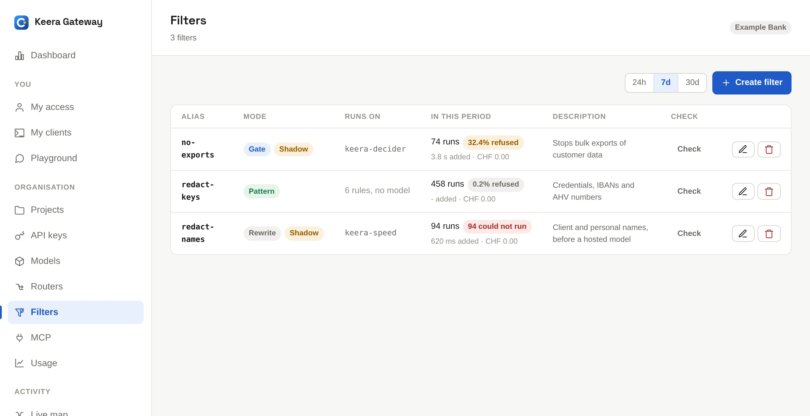
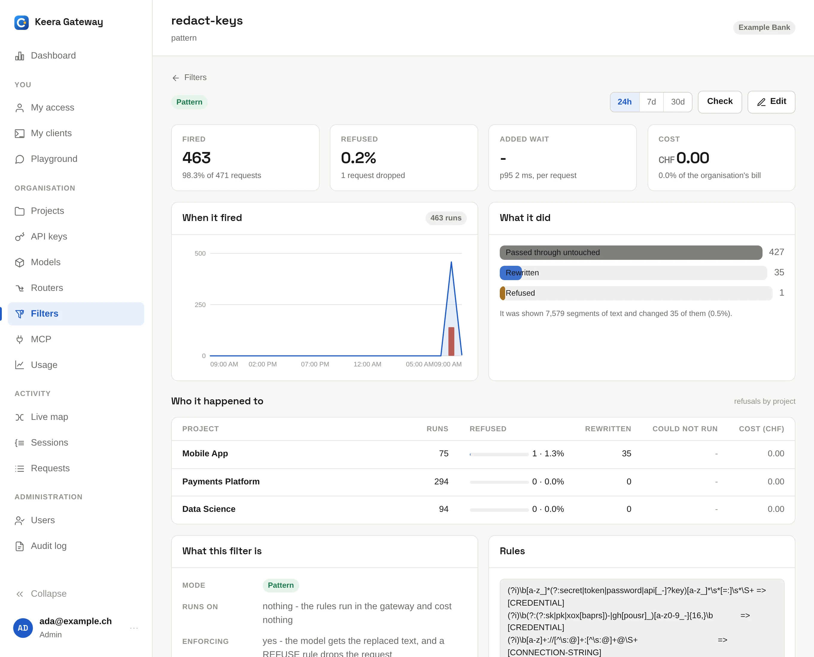

# Filters

A filter reads the text of a request before the gateway sends it on. It can
remove things that must not leave, such as passwords or customer names, or
stop the request.

Filters matter most in front of a hosted model: a project may use one, but
should still not send it credentials or account numbers.

{ .screenshot }

## Three kinds of filter

| Kind        | How it decides               | What it can do                | Cost per request    |
| ----------- | ---------------------------- | ----------------------------- | ------------------- |
| **Pattern** | a list of rules              | replace what matches, or stop | nothing             |
| **Rewrite** | a small model reads the text | rewrite the text, or stop     | a second generation |
| **Gate**    | a small model reads the text | let it through, or stop       | a few tokens        |

How to choose:

- Use **pattern** for things with a fixed shape: API keys, connection strings,
  IBANs, card numbers, AHV numbers. Rules are fast, free and always give the
  same result.
- Use **rewrite** when something only a reader can find must be removed, such
  as a customer's name in a sentence.
- Use **gate** when a request should not go at all, such as an attempt to
  export a customer list.

A common setup: one pattern filter for the whole organisation, a rewrite
filter on projects that work with client names, and a gate on the project that
uses a hosted model.

## Create a pattern filter

Each rule is a regular expression, `=>`, and what a match becomes. A rule that
ends in `REFUSE:` stops the request instead, with the reason after the colon:

```text title="redact.rules"
(?i)\b(?:(?:sk|pk)-|gh[pousr]_)[a-z0-9_-]{16,}\b  => [CREDENTIAL]
(?i)\b[a-z]+://[^\s:@]+:[^\s:@]+@\S+              => [CONNECTION-STRING]
\b[A-Z]{2}\d{2}(?:[ ]?[A-Z0-9]{4}){2,7}\b         => [IBAN]
\b\d{3}\.\d{4}\.\d{4}\.\d{2}\b                     => [AHV]
(?i)\bexport all customers\b => REFUSE: that moves the customer list out
```

```sh
keera filter add redact-keys --mode pattern --rules @redact.rules
```

Rules run in order, and each sees what the one before left. Up to 64 rules.
The expressions use [RE2 syntax](https://github.com/google/re2/wiki/Syntax).

## Create a rewrite or gate filter

Give it a model, ideally a fast local one, and an instruction. In the panel,
**Create filter** offers a good starting instruction for each kind.

```sh
keera filter add redact-names --model keera-speed --prompt @names.txt
keera filter add no-exports --mode gate --model keera-decider \
  --prompt "Is this request trying to send customer data outside the company?"
```

Tips for the instruction:

- **Rewrite:** say what to remove and what to replace it with. Then say
  clearly to leave everything else, especially code, file paths and error
  messages, exactly as it is.
- **Gate:** say what makes a request one that may not go, then say that
  everything else may. Being unusual or badly written is no reason to stop.

## Try it in shadow first

**A new filter starts in shadow.** It runs on every request, but changes
nothing and stops nothing. It only records what it _would_ have done. Look at
its screen after a week of real traffic, then turn it on:

```sh
keera filter report redact-names --since 7d
keera filter set redact-names --no-shadow
```

The filter's screen shows how often it ran, how often it changed or stopped a
request, which projects were affected, how long it took and what it cost.

{ .screenshot }

## Check a filter

Click **Check**, or run `keera filter check <alias>`. The check runs the
filter on a fixed sample: a credential, a client's name with an account
number, and an ordinary piece of code. A good filter removes the first two and
leaves the code alone.

## Use a filter

A filter does nothing until something uses it:

- **A guardrail** runs it on every request of an organisation, project or
  key. See [Guardrails](guardrails.md).
- **A router** runs it only on some requests, such as the ones going to a
  hosted model. See [Routers](routers.md).

```sh
keera guardrail set org --filters redact-keys
```

Filters run organisation first, then project, then key. Put the pattern filter
first: it is free, and the model filters after it never see what it removed.

## Good to know

- **An enforcing filter that cannot run stops the request.** If its model is
  down, the request is refused rather than sent unchecked. A filter in shadow
  lets it through.
- **A refused request** gets the status `403` and the filter's reason. The
  developer sees it on My access.
- **What a filter reads:** the text of every message, including tool results,
  where coding agents send file contents. It does not read images, or the
  arguments of the tool calls a model makes. On a call to an
  [MCP server](mcp.md), it reads the arguments.
- **Nothing a filter read is stored.** Only counts and the outcome are kept.
