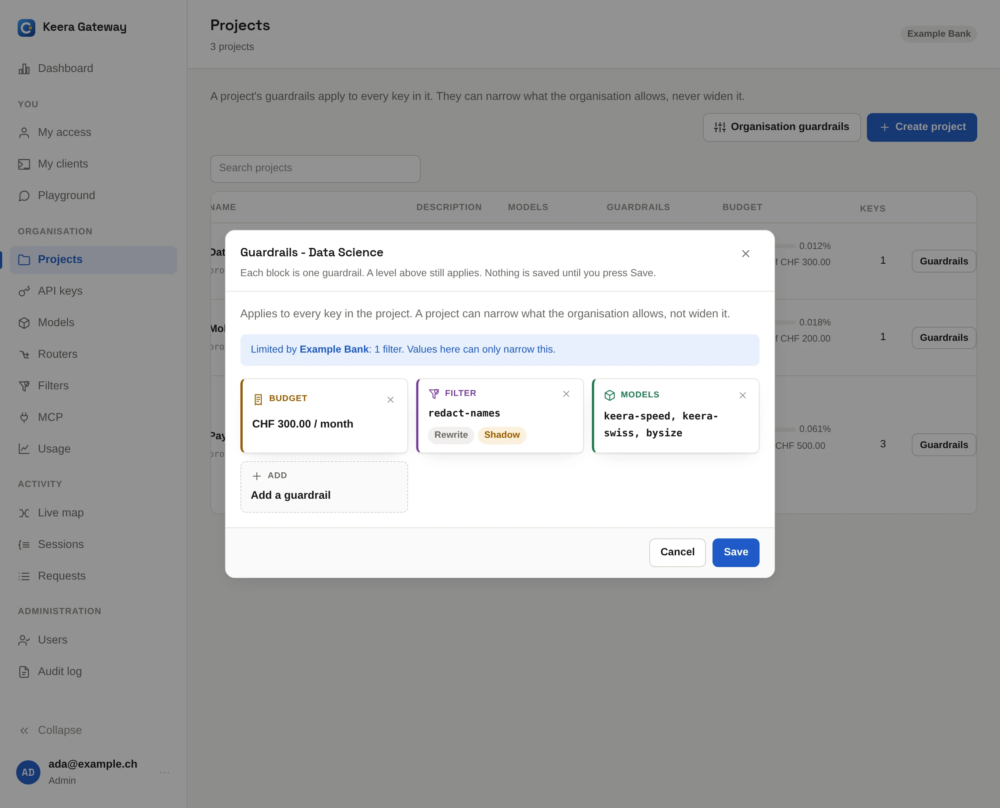

# Guardrails

A guardrail says what an organisation, a project or a key may do. Set the
broad rules on the organisation, and narrow them for each project or key.

## What a guardrail holds

| Part              | What it does                                                                                                           |
| ----------------- | ---------------------------------------------------------------------------------------------------------------------- |
| **Models**        | The models and routers that may be called. Not set means "whatever the level above allows"; an empty list allows none. |
| **Budgets**       | The most money to spend per day or per month, in CHF.                                                                  |
| **Rate limits**   | The most requests or tokens per minute, day or month.                                                                  |
| **System prompt** | An instruction put in front of every chat request.                                                                     |
| **Filters**       | [Filters](filters.md) that run on every request.                                                                       |
| **MCP tools**     | The [MCP](mcp.md) servers and tools that may be called.                                                                |

A level may have several budgets and rate limits, one per period. For example
a budget per day next to one per month. Each must hold.

## How levels combine

**A level can narrow what it inherits, but never widen it.**

- Model and tool lists must agree on every level. If the organisation allows
  `keera-speed` and `keera-frontier`, a project can allow just `keera-speed`,
  but not a third model.
- Budgets and rate limits are counted per level, and all of them apply. An
  organisation budget of CHF 10,000 and a project budget of CHF 1,000 are two
  limits.
- System prompts and filters add up, organisation first. A project keeps the
  organisation's and may add its own.

A level that sets nothing is not unlimited. It gets whatever the level above
it sets.

## Set a guardrail in the panel

On **Projects**, click **Guardrails** on a project, or **Organisation
guardrails** at the top. On **API keys**, click **Guardrails** on a key. Each
part is a block in the dialog: add the ones you need.

{ .screenshot }

## Set a guardrail on the command line

```sh
# A project may use two models, 120 requests a minute and CHF 500 a month
keera guardrail set project "Payments Platform" \
  --models keera-speed,keera-frontier --requests 120 --budget 500 --period month

# One key gets CHF 5 a day on top
keera budget key "Ada's laptop" --budget 5 --period day

# A standing instruction for the whole organisation
keera guardrail set org --system-prompt "Answer in English. Never output customer data."
```

`keera limit` and `keera budget` set one part each. With no flags, they show
what is in force.

## See what applies

Before you change a limit, check what is in force now:

```sh
keera guardrail effective key "Ada's laptop"
```

This shows the combined result, and which level decided each value.
Developers see the same on [My access](../use/my-access.md).

## Budgets and rate limits in detail

- **Budgets** reset at midnight UTC (daily) or on the 1st of the month
  (monthly). A request over budget is refused with `402`, and the message says
  when the budget resets.
- **Rate limits per minute** refill continuously. Per day or month, they reset
  like budgets. A request over the limit is refused with `429` and a
  `Retry-After` header.

!!! tip "Budget for hosted models"

    A hosted model without a guardrail is open to every key in the
    organisation. Give the projects that may use it a monthly budget.
