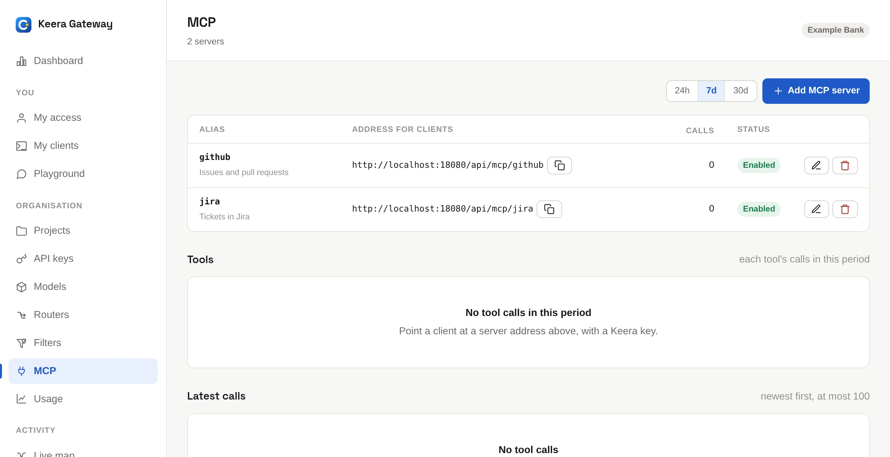

# MCP servers

Tool calls send data out just like model calls do: to an issue tracker, a chat
channel or a cloud API. So Keera Gateway can sit in front of
[MCP](https://modelcontextprotocol.io) servers too.

An agent reaches a server at `https://gateway.keera.ch/api/mcp/<alias>` with
its normal Keera key. The gateway then:

- shows the agent only the tools its key may call
- runs the key's [filters](filters.md) on what each call sends
- adds the server's credential, which never reaches a laptop
- records every call: tool, outcome, time and size, but never the content

{ .screenshot }

## Add a server

Open **MCP** and click **Add MCP server**, or run:

```sh
keera mcp add github --endpoint https://api.githubcopilot.com/mcp/ \
  --description "Issues and pull requests" --api-key @-
```

The credential is stored encrypted and sent to the server as a bearer token.
For a server that wants another header, add `--auth-header X-Api-Key`.

Only remote servers that speak MCP over HTTP can go through the gateway. A
server that runs as a local process on a laptop never passes it.

## Connect an agent

`keera mcp connect github` prints the settings for Claude Code, Codex and
other clients. See [Connect your tools](../use/connect.md#mcp-servers).

## Choose which tools a key may call

Set this in a guardrail, like the models. An entry is a server, for all its
tools, or `server/tool` for one tool:

```sh
keera guardrail set org --tools github,jira/search
keera guardrail set project "Payments Platform" --tools github/search_code
```

Each level narrows the one above. If no level sets a list, a key may call
every tool of every server. A tool the key may not call is hidden from the
agent.

A tool call counts as one request against the key's rate limits.

## See the calls

```sh
keera mcp calls --since 1h
keera mcp calls --summary --since 7d
```

Each call has an outcome: `ok`, `tool_error` (the tool said it failed),
`error` (no result came back, from the server or the gateway), `denied` (not
allowed, or over a limit), `refused` (a filter stopped it) or
`input_required` (the server asked for the user's input, and the client sends
the call again). Tool calls also show on each
[session](../monitor/requests-and-sessions.md), under its model calls.

!!! note "One identity at the server"

    The server sees the same credential for every key. Its own per-user
    permissions do not apply, so the tool list in the guardrail is your control.
