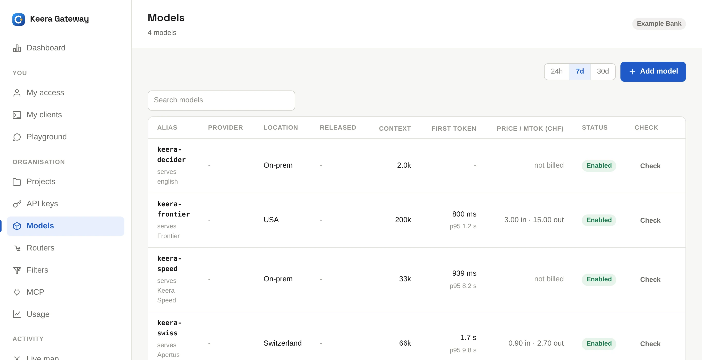
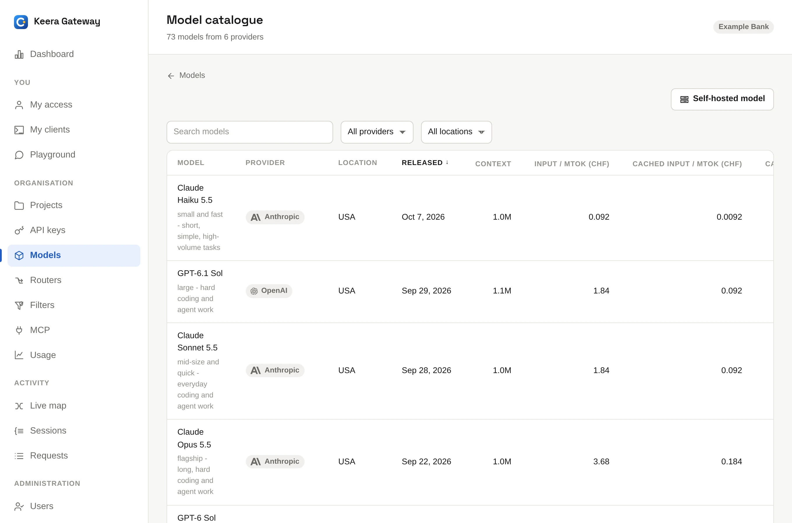

# Models

Every model belongs to one organisation. Only that organisation's keys can
call it, and its administrators add, change and remove it. A new organisation
starts with a set of models, such as `keera-speed`.

{ .screenshot }

## The alias

Tools call a model by its [alias](../get-started/concepts.md#models-and-aliases),
such as `keera-speed`. An alias uses lowercase letters, digits and hyphens,
up to 64 characters. It may also hold a slash, as in
`anthropic/claude-sonnet`. A hyphen cannot start or end the alias, or a part
between slashes.

## Add a hosted model

Open **Models** and click **Add model**. The **model catalogue** lists every
model the built-in providers offer: Anthropic, OpenAI, Google, Mistral, and the
Swiss providers Infomaniak, stepping stone, Phoeniqs and CSCS. It shows each
model's context window, location and list prices. Narrow it by location first:
that is where prompts go.

{ .screenshot }

1. Click **Add** on a model.
2. Enter the alias.
3. Click **Add model**.

The model uses the gateway's key; see [Billing](billing.md).

On the command line, `keera model catalogue` lists everything the providers
offer, and this adds one:

```sh
keera model add keera-frontier --provider anthropic --backend-model claude-opus-5-5
```

!!! warning "Prompts to a hosted model leave the gateway's private network"

    Before you offer one, decide who may use it, and set a budget and a
    [filter](filters.md). Swiss providers keep prompts in Switzerland, and
    Mistral in the EU. Anthropic, OpenAI and Google send them to the USA.

## Add your own model

For a model you run yourself, such as Keera Engine on vLLM, click
**Self-hosted model** above the catalogue. Enter:

- the **alias** and a short **description**
- the **backend URL**, which the gateway must reach, such as
  `https://llm.example.ch/v1`
- the **backend model**: the name your server serves the model under (vLLM's
  `--served-model-name`)
- the **context window** in tokens
- input and output **prices**. Requests count against budgets at these
  prices; with 0, budgets never limit the model

```sh
keera model add my-coder --backend https://llm.example.ch/v1 \
  --backend-model qwen2.5-coder --max-context-tokens 32768
```

## Write a good description

The description tells people what the model is for. [Routers](routers.md) also
read it to choose a model, so write it for that:

```sh
keera model set keera-speed --description \
  "Fast and private. Short edits, syntax questions, everyday work."
```

## Check a model

Open the model and click **Check**, or run:

```sh
keera model check keera-speed
```

The check gives the model a tool and a question only the tool can answer. It
reports whether the model made a proper tool call, whether streaming works,
and whether the server answered as the right model. Coding agents need tool
calls to edit files, so run the check after every change to a model.

## Stop using a model

- To stop one project or key from using it, leave it out of that
  [guardrail's](guardrails.md) model list.
- To stop the whole organisation, open the model and turn it off, or run
  `keera model disable <alias>`.
- To remove it, delete it, or run `keera model delete <alias>`. A filter or
  router that uses it blocks the delete until you change it. The confirmation
  lists them.

## Add models from a file

`keera model apply models.yaml` adds or updates every model a file declares.
`keera model validate models.yaml` checks the file first, without a gateway.

```yaml title="models.yaml"
models:
  - alias: my-coder
    backends: [https://llm.example.ch/v1]
    backend_model: qwen2.5-coder
    max_context_tokens: 32768
    description: Fast and our own. Short edits and everyday work.

  - alias: keera-frontier
    provider: anthropic
    backend_model: claude-opus-5-5
    description: Hosted and expensive. Design and hard reasoning.
```
