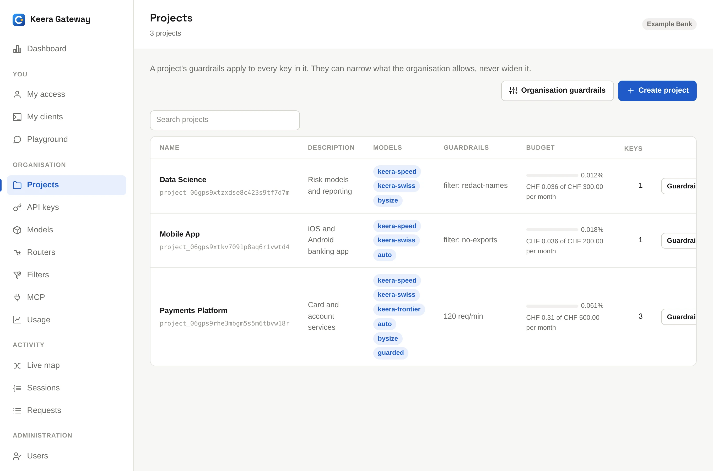
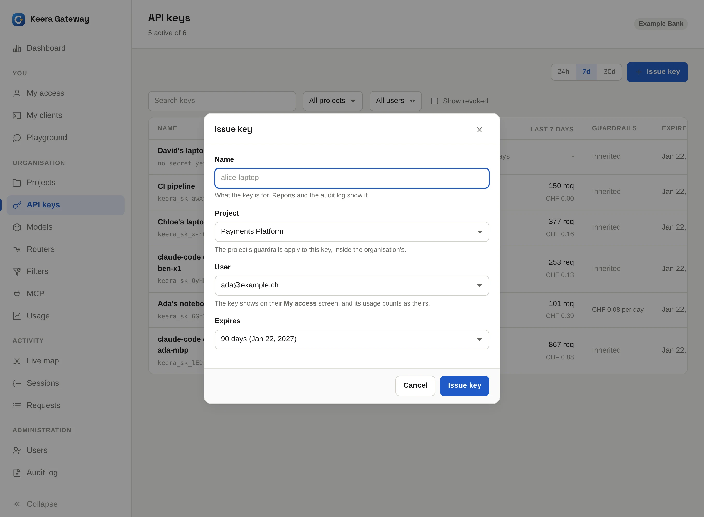
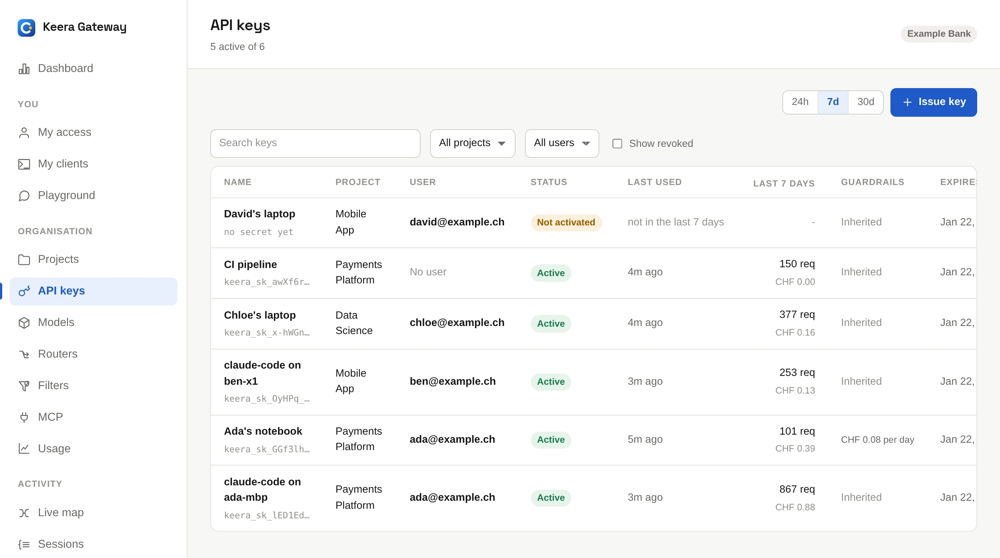

# Projects and keys

## Projects

A project groups keys, usually for one team or product. Its guardrails apply
to every key in it, and its usage is reported on its own.

{ .screenshot }

To create one, open **Projects** and click **Create project**, or run:

```sh
keera project create "Payments Platform" --description "Card and account services"
```

A new organisation starts with a project called `default`. You can rename it.
A project can only be deleted once all its keys are revoked and all its
sandboxes have ended. Expired keys and suspended sandboxes still count.

## Issue a key

Open **API keys** and click **Issue key**.

{ .screenshot }

| Field   | What it means                                                                                                                           |
| ------- | --------------------------------------------------------------------------------------------------------------------------------------- |
| Name    | What the key is for, such as `Ada's laptop` or `CI pipeline`. Reports show this name.                                                   |
| Project | The project the key belongs to, and whose guardrails it follows.                                                                        |
| User    | The person the key belongs to. Leave it empty for a pipeline.                                                                           |
| Expires | 90 days by default. You can pick another lifetime, a date, or never.                                                                    |
| Secret  | Shown when the key is for someone else. **They activate it and see it once** (the default) means only that person ever sees the secret. |

On the command line:

```sh
# For a person, who activates it themselves
keera key create --project "Payments Platform" --user ada@example.ch \
  --name "Ada's laptop" --pending

# For a pipeline, active at once
keera key create --project "Payments Platform" --no-user --name "CI pipeline"
```

**The secret is shown only once.** Keera stores only a hash of it. Nobody,
not even an operator, can read it later.

## The keys screen

{ .screenshot }

Each row shows the key's project, owner, status, recent use and expiry. From
here you can:

- **Rotate** or **Revoke** a key. See
  [Rotate or revoke a key](../use/my-access.md#rotate-or-revoke-a-key).
- Click **Guardrails** to give one key its own limits, inside its project's.
- Click the pencil to rename it.

```sh
keera key list                  # --all adds revoked keys
keera key rotate "Ada's laptop"
keera key revoke "Ada's laptop"
keera key set "Ada's laptop" --name "Ada's old laptop"
```

## When someone leaves

Disable the person on the **Users** screen. All their keys are revoked at
once. See [Users and roles](users.md#when-someone-leaves).
