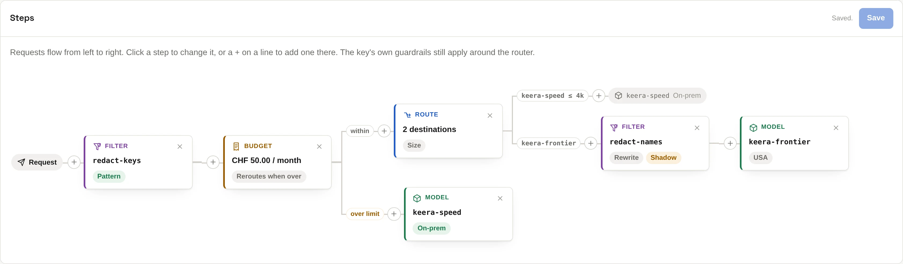

# Routers

A router is something a tool calls instead of a model. The tool puts the
router's name in the `model` field, and the router picks a model for each
request.

Use a router to:

- send small tasks to a cheap private model and hard ones to a large hosted
  model
- let your app say which model a request needs
- fall back to another model when one is down
- spread requests across several copies of a model
- redact only the requests that go to a hosted model
- switch to a private model once the hosted budget is spent

## The steps

A router is a tree of steps. A request enters on the left and ends at a model.

| Step              | What it does                                                                                             |
| ----------------- | -------------------------------------------------------------------------------------------------------- |
| **Route**         | picks one model from a list                                                                              |
| **Filter**        | runs one of your [filters](filters.md)                                                                   |
| **Budget**        | counts what passes; over the budget, takes its "over" branch, or refuses with `402` if it has none       |
| **Rate limit**    | counts requests or tokens; over the limit, takes its "over" branch, or refuses with `429` if it has none |
| **System prompt** | adds an instruction to the requests that pass                                                            |
| **Model**         | sends the request to one model                                                                           |

{ .screenshot }

This router, `guarded`, removes credentials, sends long requests to the hosted
model and short ones to the private model. On the way to the hosted model, it
also removes client names. Once CHF 50 are spent in a month, everything goes
to the private model.

## How a route step chooses

| Mode            | Picks by                                 | Extra cost           |
| --------------- | ---------------------------------------- | -------------------- |
| **Instruction** | a small model reads the request          | one short generation |
| **Size**        | how long the request is                  | none                 |
| **Header**      | a header the client sends                | none                 |
| **Fallback**    | the order of the list, until one answers | none                 |
| **Latency**     | which model answered fastest recently    | none                 |
| **Least busy**  | which model has the fewest open requests | none                 |

Only **instruction** reads what the request says. It reads each model's
description, so [write good descriptions](models.md#write-a-good-description)
first.

### Route by header

Your app may know best which of its requests are hard. A header step lets it
say so. The app sends a header, such as `X-Keera-Route: hard`, and the step
sends the request to the model you gave that value.

The app names a value, not a model. So you can point `hard` at another model
without changing the app.

- A value is lowercase letters, digits and hyphens. Case and spaces in the
  header do not matter.
- Every model in the step needs a value, or must be the fallback.
- The header cannot be one that carries the key, such as `Authorization`.

The client decides, so a header step cannot keep data inside or hold spend
down. Use an instruction step, a [filter](filters.md) or a budget for that.
Coding agents send the same headers on every request, so header steps suit
your own apps best.

## Create a router

In the panel, open **Routers** and click **Create router**. Click a step to
change it, or a **+** on a line to add a step there.

On the command line, a router with one route step:

```sh
# Let a small model decide
keera router add auto --model keera-speed \
  --destinations keera-speed,keera-frontier --fallback keera-speed \
  --prompt "Which model should answer this request?" --display-name Auto

# By size: up to 4,000 tokens to the private model, the rest to the hosted one
keera router add bysize --mode size --destinations keera-speed:4k,keera-frontier

# Fallback: the private model first, the hosted one when it is down
keera router add ha --mode fallback --destinations keera-speed,keera-frontier

# By header: the app sends X-Keera-Route: cheap or hard
keera router add byapp --mode header --header X-Keera-Route \
  --values cheap=keera-speed,hard=keera-frontier --fallback keera-speed
```

For a whole tree, write the steps as JSON and use `--file`. `keera router show
<alias> --json` prints a router in that format, so you can edit it and save it
with `keera router set`.

## When it cannot decide

An instruction step may fail to decide, for example when its model is down. A
header step cannot decide when the header is missing or has an unknown value.
Choose what happens when you create the step:

- `--fallback <model>` sends the request there. Good when the goal is saving
  money.
- `--no-fallback` refuses the request. Good when the goal is keeping data
  inside: an unchecked prompt must not go to a hosted model. A header step
  refuses with a `400` that lists the values the client may send.

## Allow the router

A key may call a router only if its guardrail allows it, like a model.
Allowing a router allows every model it can send to. To send all of a
project's traffic through a router, allow only the router:

```sh
keera guardrail set project "Payments Platform" --models guarded
```

The key's own guardrails still apply around the router. A router can never
loosen them.

## Check and watch it

**Check**, or `keera router check <alias>`, sends sample prompts through each
instruction step and shows where each went, and how sure the deciding model
was. For the other route steps, it checks that each model answers. For a header
step, it also shows which values go to each model.

Mistakes in routing are quiet: every request still gets an answer. So watch
the router's screen. It shows how requests were split between models, how
often it fell back, and what deciding added to the wait. It also shows how
much of each budget, and of each rate limit per day or month, is used. On the
command line, run `keera router report <alias>`.

A tool can see where its request went in the `X-Keera-Router` header, such as
`auto -> keera-frontier`.
