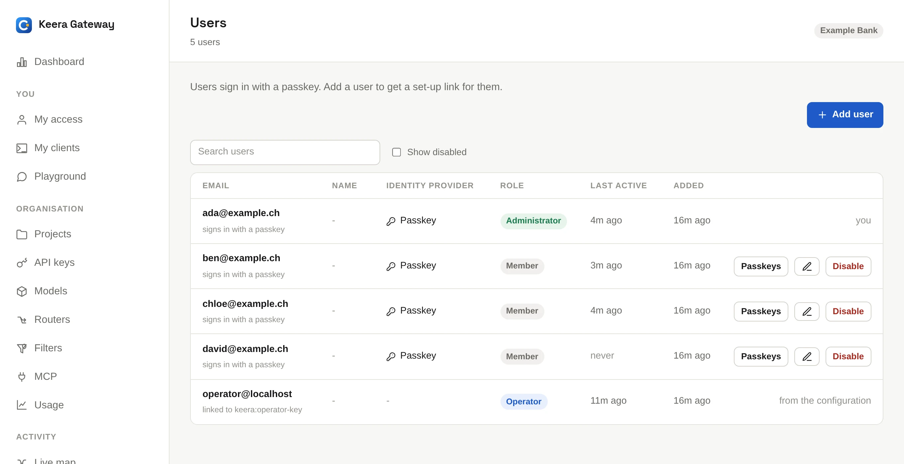

# Users and roles

## Roles

| Role              | What they can do                                                                                                                                                                                         |
| ----------------- | -------------------------------------------------------------------------------------------------------------------------------------------------------------------------------------------------------- |
| **Member**        | Use, rotate and revoke their own keys, and run their own sandboxes. See the organisation's usage, and their own sessions and requests. Read the organisation's models, filters, routers and MCP servers. |
| **Administrator** | Everything in the organisation: people, projects, keys, models, guardrails, filters, routers, MCP servers, sandbox classes.                                                                              |
| **Operator**      | Everything, in every organisation. Set by the gateway's settings, never in the panel.                                                                                                                    |

## Add a person

Open **Users** and click **Add user**, or run:

```sh
keera user add ada@example.ch --role admin
```

{ .screenshot }

The row you added is an invitation. It becomes theirs when they first sign
in with that address.

For someone without such an account, choose **Signs in with: A passkey**, or
add `--passkey`. You get a set-up link that works once, for 24 hours. Send it
to the person privately. The address must be at your organisation's email
domain, if it has one. Only an operator can add a passkey account at another
domain.

```sh
keera user add ben@example.ch --passkey
keera user passkey-link ben@example.ch   # a new link, for a lost device
```

## Change a role

```sh
keera user role ada@example.ch admin
```

Or use the role menu on the **Users** screen. The person is signed out of this
organisation, so the new role applies at once.

## When someone leaves

Disable them:

```sh
keera user disable ada@example.ch
```

Or click **Disable** on the **Users** screen. At once:

- they cannot sign in, and all their sign-ins end
- every key that belongs to them is revoked for good
- their passkeys are deleted
- their agent sandboxes, and any not started yet, end; the rest are suspended

Disabled people are hidden from the **Users** screen and from
`keera user list`; add `--all` to see them. Their usage and audit entries keep
their name. `keera user enable` lets them back in, without their old keys.
Someone who signs in with a passkey also needs a new
[set-up link](#add-a-person).
