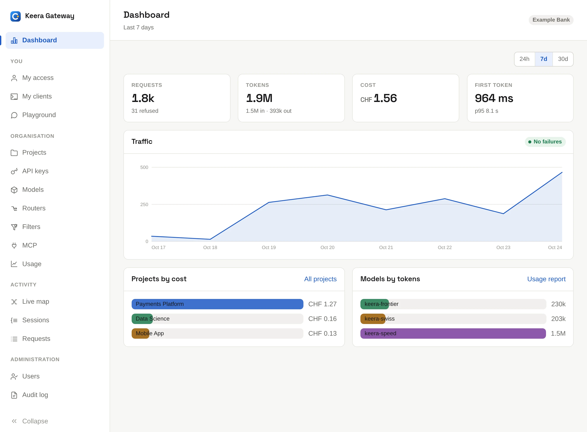
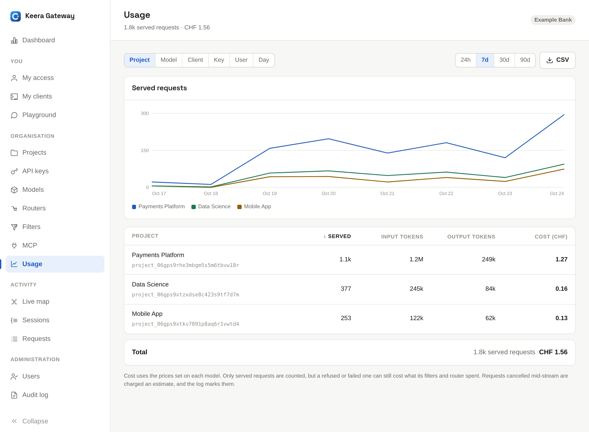

# Dashboard and usage

## Dashboard

The **Dashboard** shows the last 24 hours, 7 days or 30 days at a glance:
requests, tokens, cost and the time to the first token, the traffic over time,
and the projects and models that use the most.

{ .screenshot }

## Usage

**Usage** breaks the numbers down by project, model, client, key, user or day.
Pick a breakdown and a time window. **CSV** downloads the table.

{ .screenshot }

The same report on the command line:

```sh
keera usage --by project
keera usage --by model --since 30d
keera usage --by client
```

## What a cost means

Costs come from the prices set on each model, in CHF.

- For a hosted model, this is the provider's list price; see
  [Billing](../manage/billing.md).
- For your own models, the price is 0 unless you set one, for example to
  charge teams internally.
- A request cut off by the client is charged on an estimate, and marked as
  such in the request log.

## Failures

```sh
keera failures
```

lists the requests that failed with a 5xx status, with what the model or the
gateway said. Add `--kind refused` for requests the gateway refused,
`--kind interrupted` for ones cut off, or `--kind all`. Each one opens with `keera session show <request-id>`.
