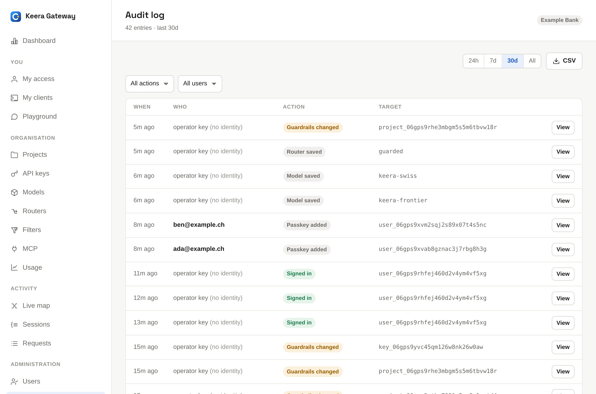

# Monitor

Every request through the gateway is written to the request log. All the
numbers in the panel are counted from it: requests, tokens, cost and how long
things took. It never holds the text of a prompt or an answer.

| Screen                                            | Answers                                                     |
| ------------------------------------------------- | ----------------------------------------------------------- |
| [Dashboard and usage](dashboard.md)               | How much is used, by whom, and what does it cost?           |
| [Live map](live-map.md)                           | What is connected, and how much leaves the private network? |
| [Requests and sessions](requests-and-sessions.md) | What happened to this request, or this task?                |
| [Audit log](#audit-log)                           | Who changed what, and when?                                 |

**Administrators** see everything in their organisation. **Members** see the
organisation's dashboard and usage, but only their own requests, sessions and
live map.

## Audit log

The **Audit log** records every change to the organisation: who did it, when,
and what changed. Examples are a new key, a changed guardrail, a deleted
model, a role change or a sign-in to another organisation. Model, filter and
router checks are recorded too, so you can show when a model last worked.

{ .screenshot }

Filter it by time and by kind of change. **View** shows the full entry, and
**CSV** downloads the list.
