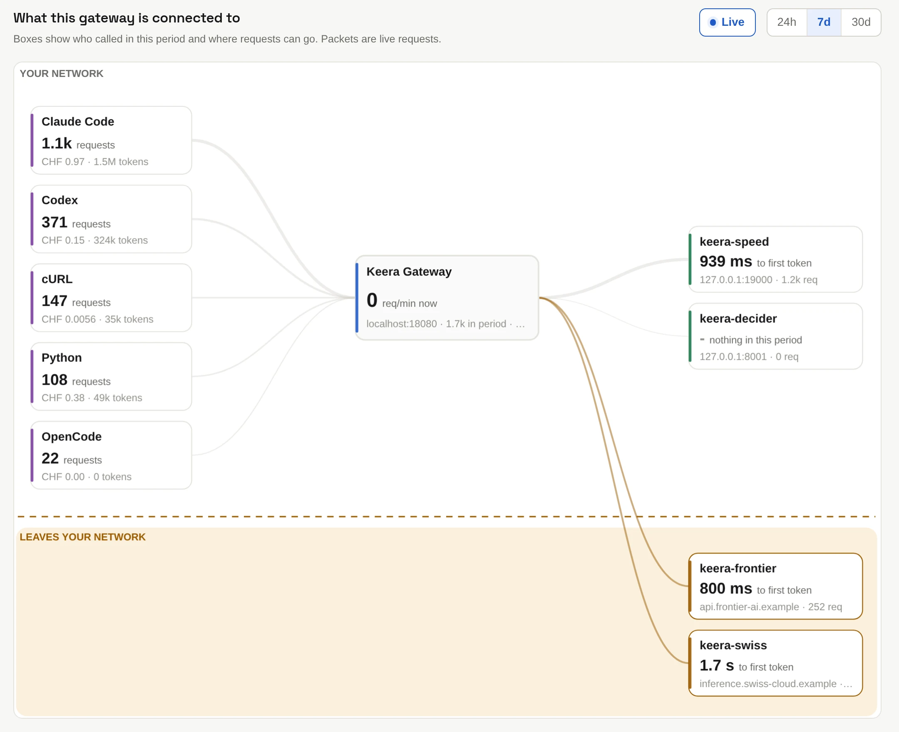

# Live map

The **Live map** shows what the gateway is connected to. Tools that called it
are on the left, models on the right. With **Live** on, each request moves
across the map as it happens.

{ .screenshot }

The dashed line is the edge of the gateway's private network:

- **Above the line** are models served inside it, such as Keera Engine.
  Prompts sent to them stay there.
- **Below the line**, in **Leaves your network**, are hosted models. Every
  request to them crosses the line, so you see at once how much of your
  traffic leaves, and what it costs.

Below the map, two tables list every model with where it runs, and every
client with its requests, tokens, refusals and cost.

!!! tip "Where a model runs"

    Keera decides this from the model's address. A private address or an
    internal host name, such as `keera-engine`, is inside the gateway's private
    network. Any other address is outside.
