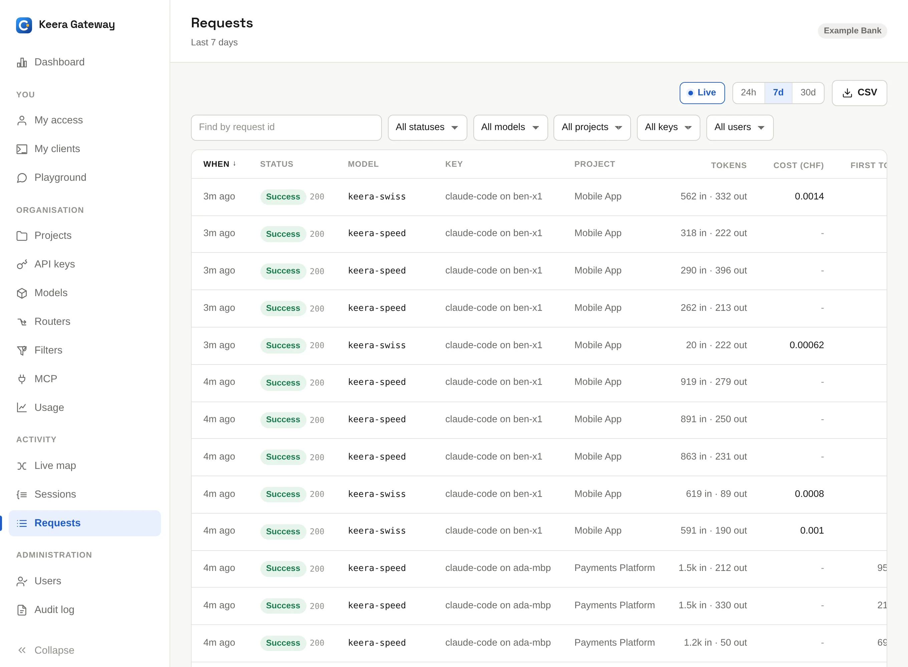
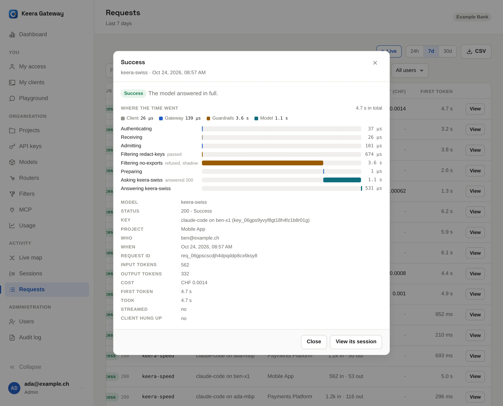
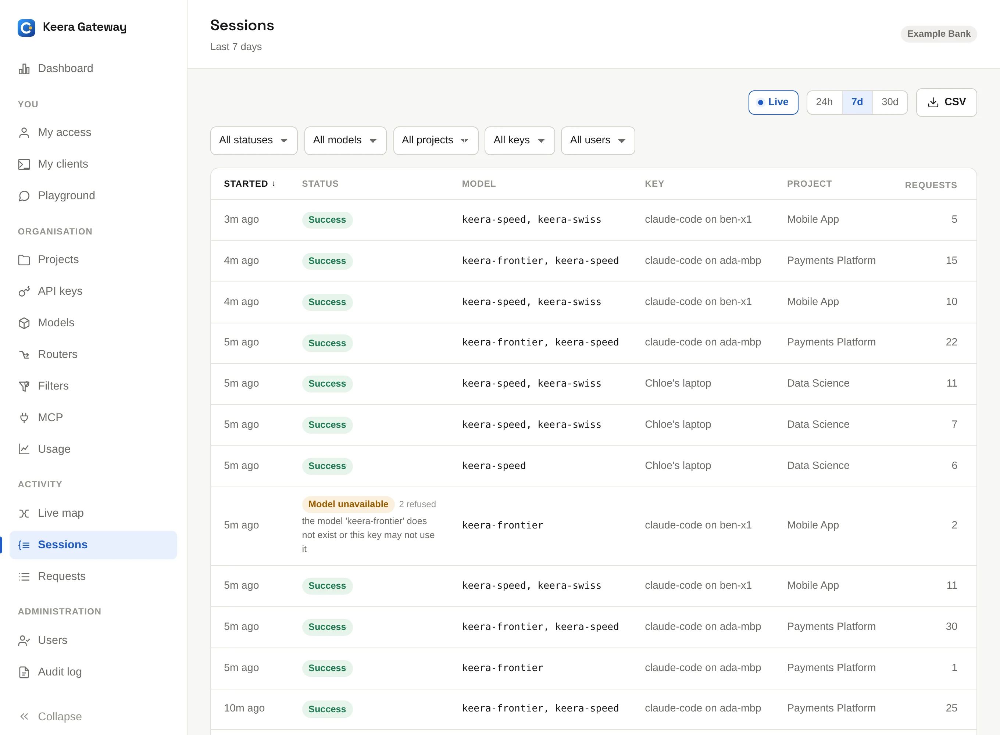
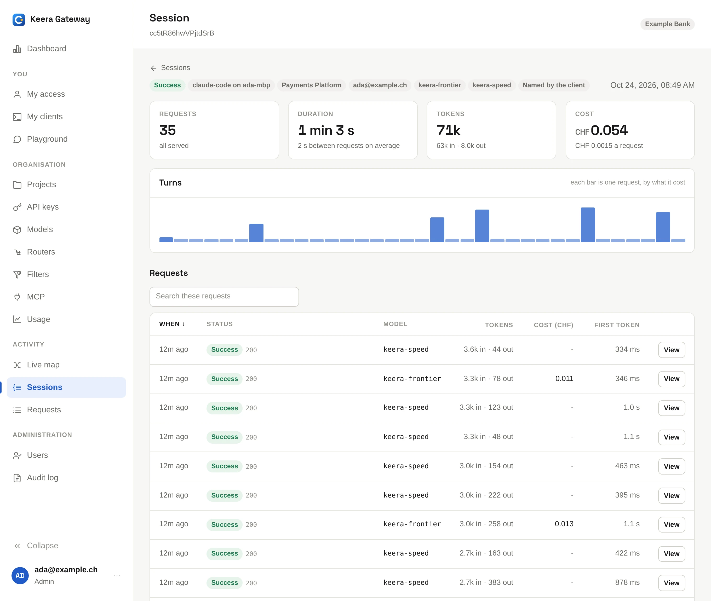

# Requests and sessions

## Requests

**Requests** is the request log: one row per request, newest first. Filter it
by model, project, key, person or status, or search for a request id. Click a
column such as **Cost** or **Tokens** to rank the whole time window by it.
**Live** shows new requests as they arrive.

{ .screenshot }

Click **View** to open a request. It shows who sent it, which model answered,
the tokens and cost, and where the time went: in the gateway, in each filter
and in the model.

{ .screenshot }

A developer who says "my agent stopped this afternoon" can find the answer
here, or on their own [My access](../use/my-access.md) page. Every refusal is
logged with the message the tool received.

## Sessions

A coding agent turns one instruction into thirty or forty requests. A
**session** groups the requests of one task, so you can see what a task
cost: "CHF 1.20, eleven minutes, 41 requests".

{ .screenshot }

Click **Cost**, **Tokens**, **Requests** or **Duration** to find the tasks
worth a closer look. The latest task is rarely the interesting one.

Opening a session shows its requests in order, with one bar per request,
sized by cost. Even bars are an agent at work. A long row of identical small
bars is an agent going in circles. A red bar is where the task went wrong.

{ .screenshot }

### How Keera finds a session

Requests belong to one session when they are part of the same conversation
and no more than 30 minutes apart.

- Claude Code sends its own session id, so its sessions are exact.
- Other tools can send one session id per conversation in a header; see
  [The API](../use/api.md#headers-you-can-send). The same id on every request
  still splits into sessions at each 30-minute pause.
- Otherwise, Keera recognises the conversation by its key and first message.
  Two tasks that start alike can merge. Keera stores only a short hash of the
  message, never the text.

### On the command line

```sh
keera session list                     # the most expensive tasks of the last 7 days
keera session list --sort requests     # the tasks that would not stop
keera session list --unhappy           # only the ones with problems
keera session show <request-id>        # one task, from start to end
```
