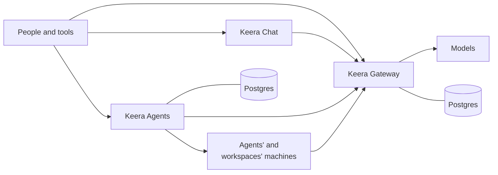

# Self-host

This part is for **operators**: whoever runs Keera on their own hardware. To
use the public instance at <https://gateway.keera.ch>, you can skip it.

## What runs

| App                                  | Image                             | Port   | Needs                                 |
| ------------------------------------ | --------------------------------- | ------ | ------------------------------------- |
| [Keera Gateway](install.md)          | `ghcr.io/bespinian/keera-gateway` | `8080` | Postgres 14 or later                  |
| [Keera Chat](chat.md) (optional)     | `ghcr.io/bespinian/keera-chat`    | `8090` | the gateway; it keeps no state        |
| [Keera Agents](agents.md) (optional) | `ghcr.io/bespinian/keera-agents`  | `8070` | the gateway, Postgres, and Kubernetes |

Each app is one static program in a `FROM scratch` image, for `linux/amd64`.
Each reads its settings from environment variables, and creates and updates
its database tables itself.

## Choose how to run it

|               | [Compose](install.md#one-host-with-compose) | [Kubernetes with Helm](kubernetes.md) |
| ------------- | ------------------------------------------- | ------------------------------------- |
| For           | a laptop, a demo, one host                  | a team, production                    |
| Keera Gateway | with Postgres and a model                   | chart `keera-gateway`                 |
| Keera Chat    | one more container                          | a Deployment of your own              |
| Keera Agents  | for development only                        | chart `keera-agents`                  |

## Set it up

1. [Install the gateway](install.md), put TLS in front, and create the first
   organisation.
2. Set up [single sign-on or passkeys](sign-on.md), so people sign in as
   themselves.
3. To give everyone a chat in the browser, [run Keera Chat](chat.md). For
   agents and workspaces, [run Keera Agents](agents.md).
4. To let a Claude plan pay for Claude Code, set up
   [Claude plans](claude-plans.md).

Every setting of the gateway is in [Settings](settings.md). When something
does not work, start with [Troubleshooting](troubleshooting.md).

## The operator

Operators work in every organisation; [Roles](sign-on.md#roles) says who is
one. Before single sign-on is set up, the operator key is the way in.

The panel's **Organisations** screen is for operators. It lists every
organisation, and creates, edits and deletes them. It also lifts the limit of
an organisation that [signed up](sign-on.md#organisations-and-domains) on its
own, as `keera org set --lift-limit` does.

With card payments on, operators can **Grant credit**, **Bill by invoice** and
**Add recurring charge** on an organisation's **Billing**, or with
`keera billing grant`, `invoiced`, `charge` and `end-charge`.
