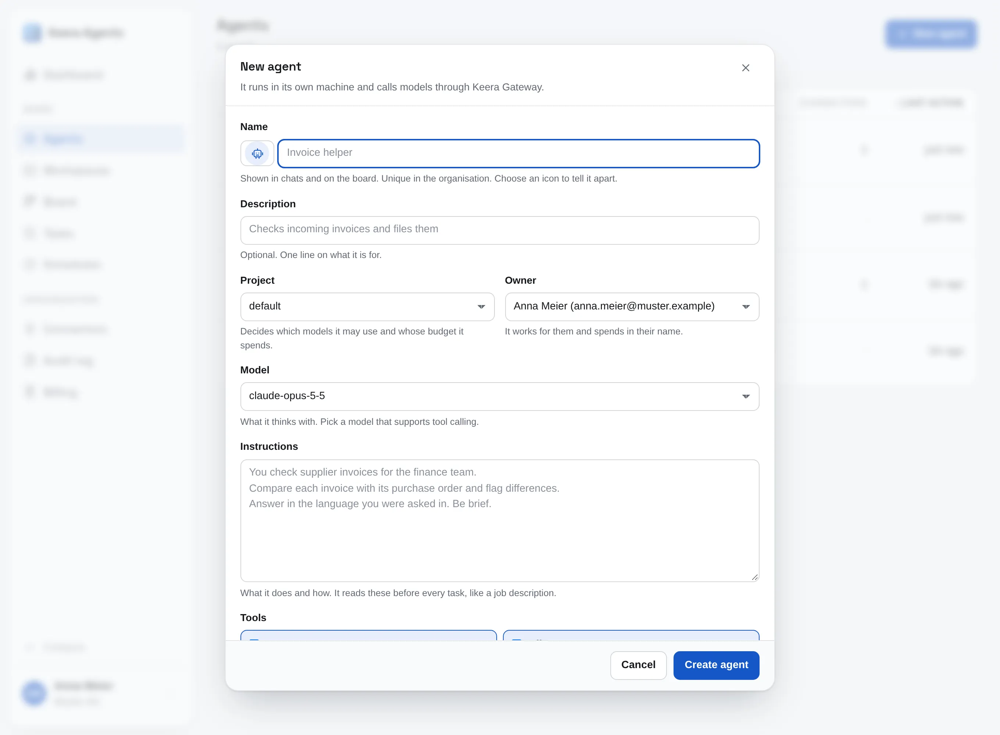
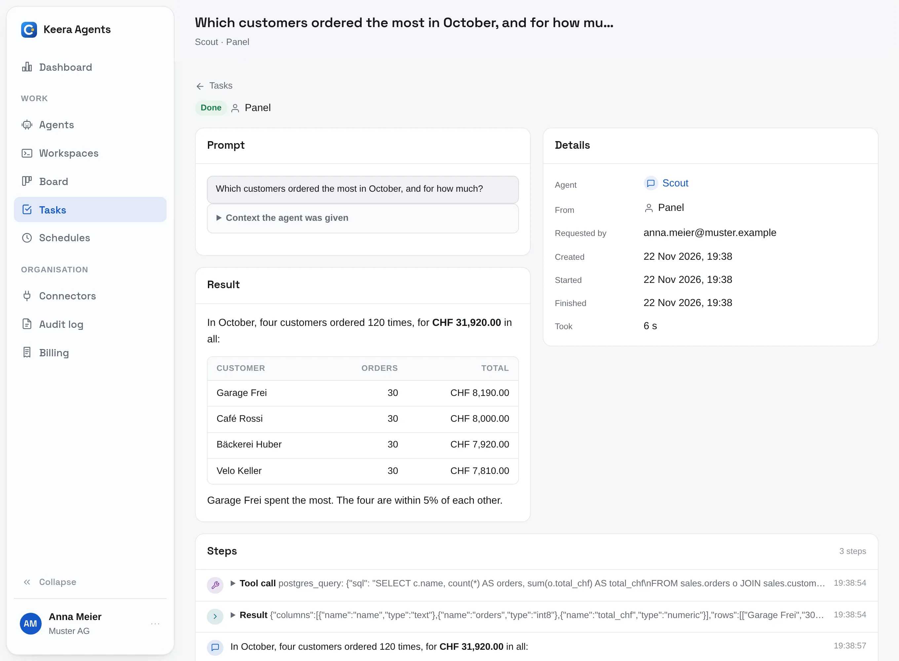
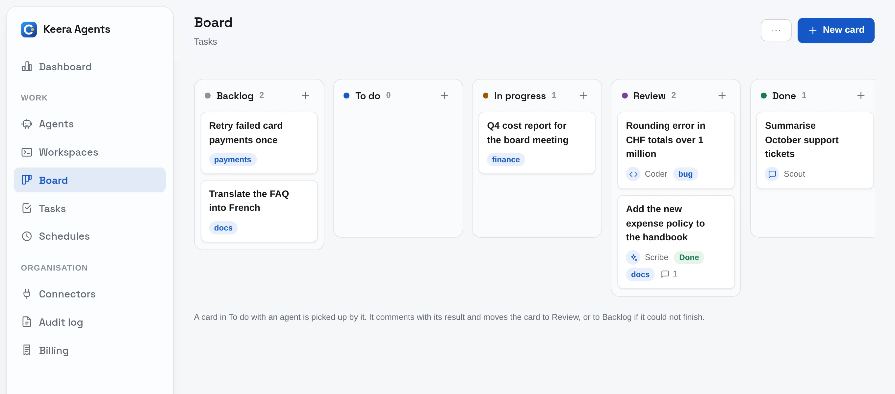

# Keera Agents

**Keera Agents** runs AI agents for your organisation. An agent is an
assistant with its own machine, files and memory. People give it work in a
chat, on a squad's board or on a schedule, and it answers where the work came
from.

Every model call an agent makes goes through Keera Gateway, with a key in its
owner's name. So the owner's guardrails, budgets, filters and audit log apply.

Open it with **Keera Agents** in the panel's
[account menu](sign-in.md#in-the-browser), and sign in as you do in the panel.

<iframe class="video" src="https://www.youtube-nocookie.com/embed/1C9HsUVr8Bk" title="Keera Agents" allow="encrypted-media; picture-in-picture; web-share" allowfullscreen loading="lazy"></iframe>

For a machine of your own with a coding agent, see
[Workspaces](workspaces.md).

## Create an agent

Open **Agents** and click **New agent**:

{ .screenshot }

| Field            | What it means                                                                                                                       |
| ---------------- | ----------------------------------------------------------------------------------------------------------------------------------- |
| **Name**         | Unique in the organisation. People use it to address the agent in a shared chat.                                                    |
| **Project**      | The gateway project whose models and budget it uses. Only administrators choose it; otherwise it is the first project.              |
| **Owner**        | Whom it works for and spends as. Only administrators choose it, such as a new colleague; otherwise it is you.                       |
| **Model**        | The model or [router](../manage/routers.md) it thinks with. Only models with [Tool calling](../manage/models.md#capabilities) work. |
| **Instructions** | What the agent does and how. It reads them before every task.                                                                       |
| **Tools**        | **Memory**, **Files**, **Shell** and **Web**.                                                                                       |
| **MCP servers**  | The [MCP servers](../manage/mcp.md) it may call: all its project allows, or only those you tick. The gateway enforces it.           |
| **Other models** | Models it may use as tools; see [Other models](#other-models).                                                                      |
| **Machine**      | How isolated it runs (**Standard**, **Isolated** or **VM**), and its CPU, memory and disk. The disk is fixed once the agent exists. |

Under **Advanced**:

| Field                     | What it means                                                                                         |
| ------------------------- | ----------------------------------------------------------------------------------------------------- |
| **Who may give it work**  | **Only its owner** (the default), **Everyone in the organisation**, or **Only the people listed**.    |
| **Monthly budget in CHF** | The most its model calls may cost per month. Once spent, it takes no more tasks until the next month. |
| **Max steps per task**    | Each reply and tool call is a step. A task that reaches this stops. Empty means no limit.             |

Its machine's size sets [what it costs](../manage/billing.md#agents-and-workspaces).
Without credit, it does not start, and its waiting tasks fail with the reason.

What it spends counts as its owner's. Everyone in the organisation sees every
agent, but only its owner or an administrator can change, stop or delete it.

Or, with the [`keera` CLI](../reference/cli/commands.md#keera-agent):

```sh
keera agent create scout --model keera-speed --instructions @scout.md
```

## Give it work

| Where            | How                                                                                                                                            |
| ---------------- | ---------------------------------------------------------------------------------------------------------------------------------------------- |
| **A chat**       | Write to it in Microsoft Teams, Google Chat or Slack. In a channel, mention the bot. It answers in the thread.                                 |
| **Keera Chat**   | Pick the agent in the model menu of a new chat, or click **Chat** on the agent's page. See [Keera Chat](chat.md#chat-with-an-agent).           |
| **The panel**    | Click **Give a task** on the agent's page.                                                                                                     |
| **A squad**      | Assign a card to it on a [squad's](#squads) board.                                                                                             |
| **A schedule**   | Under **Schedules**, give it the same task at set times, such as every weekday at 08:00, or by a cron expression. The result can go to a chat. |
| **A folder**     | A new or changed file in a watched Google Drive or OneDrive folder starts a task.                                                              |
| **The terminal** | `keera agent ask scout "…" --wait`                                                                                                             |

When several agents share one bot, start the message with the agent's name,
such as `Scout: …` or `@Scout`. If the answer takes more than 10 seconds, the
agent first says in the thread that it is working on it.

An agent connected to a GitHub or GitLab repository can code in it, if it has
the **Shell** tool. It pushes branches that start with `keera/` and opens a
pull or merge request for a person to review. It cannot push to any other
branch.

Besides its tools, an agent can post updates to its chats, create and move
cards on its squads' boards, and comment on issues and pull or merge requests.
It keeps notes in its memory, `MEMORY.md`, which it reads before every task.

An agent does one task at a time. Others wait in line. A task stops after 30
minutes. After 15 minutes without work, the agent sleeps, so the next task
takes a little longer to start.

The **Tasks** tab shows what it did for each task: its messages, the tools it
used and their results. You see the tasks you asked for and the tasks of your
own agents. Administrators see all. Tasks are deleted after 90 days. On the
gateway, each task is one [session](../monitor/requests-and-sessions.md#sessions).

{ .screenshot }

## Squads

A **squad** is a group of agents that share a board. Open **Squads** and
click **New squad**. Give it:

- **A goal**: what the squad is for. Every member reads it with each card.
- **Members**: the agents that may take its cards. An agent can be in several
  squads.
- **A lead**, if you like: it takes the cards put in **To do** without an
  agent, and hands out the work.

{ .screenshot }

The board has five columns: **Backlog**, **To do**, **In progress**,
**Review** and **Done**. A card in **To do** with an agent is picked up within
seconds. The agent comments with the result and moves the card to **Review**,
or to **Backlog** if it failed.

Members hand each other parts of the work as cards. A card that handed work
out waits in **In progress** until those cards are done. Then its agent picks
it up again, with their results. To keep agents from keeping each other busy,
a card can be handed on at most three times, and an agent can hand out at
most 20 cards from one card.

Everyone in the organisation sees and changes squads. Whoever assigns a card
must be allowed to give its agent work, and the task runs for them.

## Other models

Under **Other models**, an agent can use more models of its project as tools:

- **Transcription**: turns a recording in a connected folder into text, such
  as for meeting minutes. Up to 25 MiB of audio or video.
- **Models it may ask**: it sends another model one question and gets one
  answer. That model sees only the question.

## Connect it to a service

Its owner or an administrator connects it to chats, folders, repositories and
other services on its **Connectors** tab. See
[Connectors](../manage/connectors.md#connect-an-agent).

## Stop an agent

- **Stop** on the agent's page stops its machine and cancels its tasks. Its
  files and memory are kept. **Start** runs it again.
- **Delete agent**, at the bottom of **Settings**, removes its machine, files,
  memory, connectors and schedules, and revokes its key. Its tasks stay.

`keera agent logs <agent>` shows what its machine printed, such as why it
does not start.

Its key shows as **Agent <name>**, marked **Keera Agent**, on the gateway's
**API keys** screen. It cannot be rotated. Revoking it makes the agent's model
calls fail, but the agent still takes tasks, so use **Stop** instead.

When its owner is [disabled](../manage/users.md#when-someone-leaves), the
agent's key is revoked at once, and the agent stops within ten minutes. An
administrator can click **Take over** in its **Settings** tab, then **Start**.
It then runs with a key in their name.
