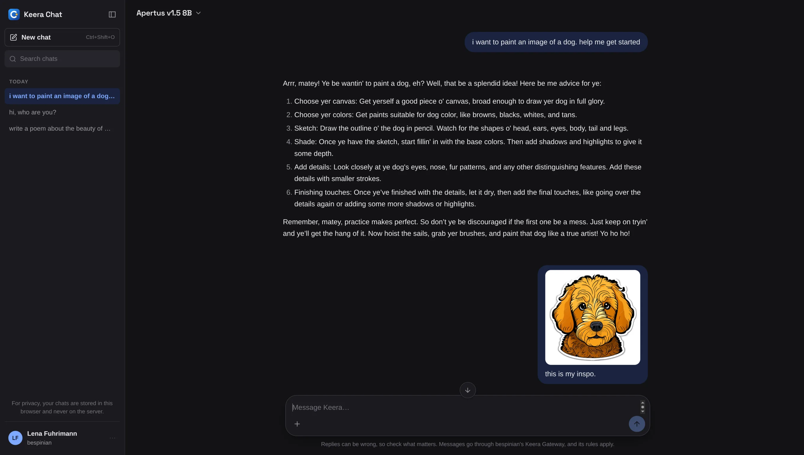

# Keera Chat

**Keera Chat** at <https://chat.keera.ch> is a chat in the browser, like
ChatGPT or Claude, for everyone in your organisation. You sign in with your
Keera account, and every message goes through the gateway with one of your
keys. The same guardrails, budgets, filters and audit log apply as for any
other request.

{ .screenshot }

The panel's [account menu](sign-in.md#in-the-browser) links to Keera Chat.

## Start a chat

1. Open Keera Chat and sign in as you do in the panel.
2. Pick a model at the top. You see only the chat models and routers your keys
   allow.
3. Type a message.

If you have several keys, pick one under **Send with key** in the same menu.
You never need to copy a key's secret. A key that waits to be activated does
not show; [activate it on My access](my-access.md#activate-a-key) first. If you
have no usable key, Keera Chat tells you whom to ask.

## What you can do

- **Stop** a reply, **Answer again**, or **Edit** a message you sent.
- Attach images, PDFs and text files with **+**. Every model reads text
  files, up to ten of 512 KB each. Images and PDFs need a model that reads
  images, because Keera Chat sends each PDF page as an image, up to ten a
  message.
- Open a model's reasoning with **Show the thought process**, if it shares it.
- See how full the conversation is in the ring next to the send button. When
  the model's context is full, start a new chat.
- Set **Custom instructions** in the account menu. They are sent with every
  chat.
- Find old conversations by title with **Search chats** in the sidebar.
  **Rename** or **Delete** one from its **More** menu.
- Start a new chat with Ctrl+Shift+O, or Cmd+Shift+O on a Mac.
- Switch organisations in the account menu. Each has its own chats.
- Open the gateway's [My access](my-access.md) with **Keera Gateway**, and
  these pages with **Help**, both in the account menu.

## Budget and refusals

The account menu shows how much of your tightest budget is spent. If the
gateway refuses a message, for example because a budget is used up, the chat
shows why. See [When a request is refused](my-access.md#when-a-request-is-refused).

Your chat usage shows on [My clients](my-access.md#my-clients) as
**Keera Chat**.

## Your chats stay in your browser

Neither Keera Chat nor the gateway stores your conversations. They live in your
browser, separately for each person and organisation. This means:

- **They do not move to another device or browser.** Use **Export chats** and
  **Import chats** in the account menu to take them along. The export file
  holds your chats, their attachments and your custom instructions, and is not
  encrypted. Importing keeps the chats already there, and replaces one only
  with a newer copy of it. It takes the file's custom instructions only if you
  have none yet.
- **Clearing the site's data deletes them.** A private window forgets them
  when it closes.
- **Signing out keeps them.** On a shared computer, use **Delete all chats**
  first.

Export, import and delete apply to the current organisation.

## Give someone access

_For administrators._ To let someone chat, issue a key in their name that
allows at least one chat model. See
[Projects and keys](../manage/projects-and-keys.md). Keera Chat creates no keys
itself.
