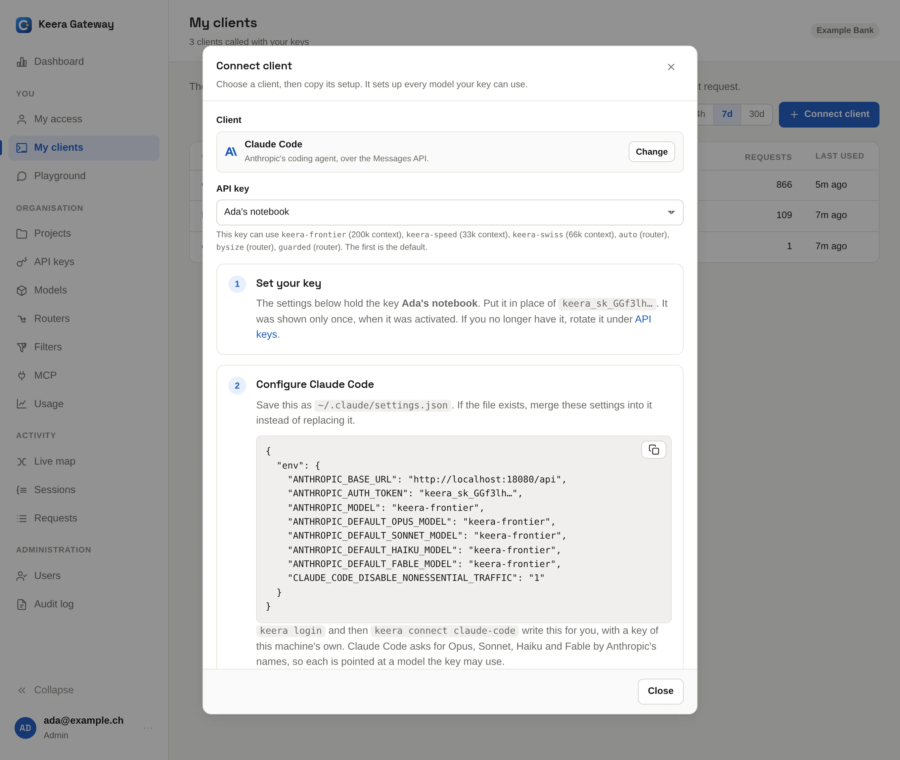

# Connect your tools

Every tool talks to `https://gateway.keera.ch/api`; OpenAI clients add `/v1`.
Give each machine and tool a key of its own, so you can replace one without
breaking the others.

!!! tip "Let the panel write it for you"

    In the panel, open **My clients** and click **Connect client**. Pick your
    tool, and the panel shows the exact settings, with the models you may
    use filled in. Your key is filled in right after you activate it; later,
    only its start is shown.

{ .screenshot }

## Claude Code

Two commands set up Claude Code on this machine:

```sh
keera login
keera connect claude-code
```

This gives the machine its own key and writes it into
`~/.claude/settings.json`, together with every model you may use. The rest of
the file stays as it was. If you set `CLAUDE_CONFIG_DIR`, it writes
`settings.json` there instead. Run `claude` in your project, and `/model`
switches between your models.

As a member, the command activates the key an administrator issued for you.
It cannot use a key you already activated elsewhere, so leave the key for
Claude Code to activate.

- `--model <alias>` picks the model Claude Code starts with.
- `--print` shows the settings instead of writing them, for another machine.
- Run the command again to replace the key with a new one.

!!! warning "Keep the key out of Git"

    Never put the key in a project's `.claude/settings.json`. That file is
    usually committed.

## Codex, OpenCode, Pi and others

`keera connect` lists the tools your gateway knows. Name one, and it prints
that tool's settings, with the models you may use filled in:

```sh
keera connect               # the list of tools
keera connect codex         # the settings for ~/.codex/config.toml
keera connect pi --key laptop
```

`--key` picks which of your keys to use, by name or id. Without it, `keera`
takes your first active key. It also says which file the settings belong in. If that file exists already,
merge the settings into it rather than replacing it.

## Any OpenAI client

Anything that takes an OpenAI base URL and an API key works. Use:

- **Base URL**: `https://gateway.keera.ch/api/v1`
- **API key**: your Keera key, `keera_sk_…`
- **Model**: an alias you may use, such as `keera-speed`

=== "Python"

    ```python
    import os
    from openai import OpenAI

    client = OpenAI(
        base_url="https://gateway.keera.ch/api/v1",
        api_key=os.environ["KEERA_API_KEY"],
    )
    reply = client.chat.completions.create(
        model="keera-speed",
        messages=[{"role": "user", "content": "Hello"}],
    )
    print(reply.choices[0].message.content)
    ```

=== "cURL"

    ```sh
    curl https://gateway.keera.ch/api/v1/chat/completions \
      -H "Authorization: Bearer $KEERA_API_KEY" \
      -H "Content-Type: application/json" \
      -d '{"model": "keera-speed", "messages": [{"role": "user", "content": "Hello"}]}'
    ```

=== "Anthropic SDK"

    ```python
    import os
    from anthropic import Anthropic

    client = Anthropic(
        base_url="https://gateway.keera.ch/api",
        auth_token=os.environ["KEERA_API_KEY"],
    )
    reply = client.messages.create(
        model="keera-speed",
        max_tokens=1024,
        messages=[{"role": "user", "content": "Hello"}],
    )
    print(reply.content[0].text)
    ```

To see which models your key may use:

```sh
curl https://gateway.keera.ch/api/v1/models -H "Authorization: Bearer $KEERA_API_KEY"
```

## MCP servers

Your administrator can put MCP servers behind the gateway too. Use the same
key. `keera mcp connect <server>` prints the settings, for example:

```sh
claude mcp add --transport http github https://gateway.keera.ch/api/mcp/github \
  --header "Authorization: Bearer $KEERA_API_KEY"
```
