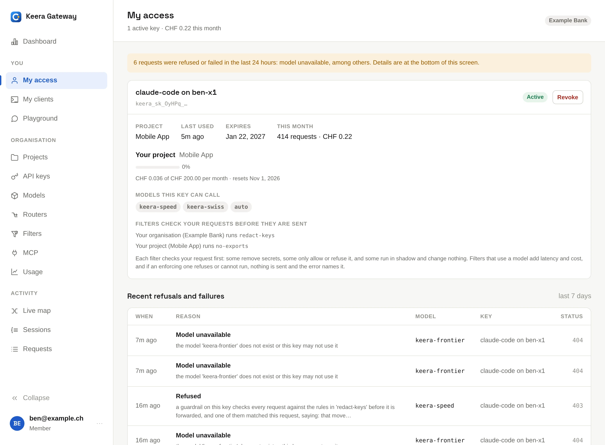

# My access

**My access** is your own page in the panel. It shows each of your keys, and
for each one:

- the project it belongs to, when it was last used and when it expires
- this month's requests and spend
- how much of the budget is used, and when the budget resets
- the models it may call
- the instructions added before your messages, if any
- the filters that check its requests

Below the keys, it lists the requests that were refused or failed in the last
7 days, with the reason.

{ .screenshot }

## Activate a key

An administrator can issue a key for you without seeing its secret. It shows
as **Not activated** until you activate it. Click **Activate** on My access,
and copy the secret: it is
[shown only once](../manage/projects-and-keys.md#issue-a-key). Or run:

```sh
keera key activate <key>   # its name or id
```

For Claude Code, let `keera connect claude-code` activate the key instead;
see [Connect your tools](connect.md#claude-code).

## Rotate or revoke a key

On the **API keys** screen, or with `keera key rotate` and `keera key revoke`.
My access also has **Revoke**.

- **Rotate** replaces a key with a new one in the same project, with the same
  guardrails and the same lifetime, counted from now. The old key stops
  working at once. Do this when a key may have leaked.
- **Revoke** stops a key for good.

Only administrators issue new keys. Ask yours when you need one.

## My clients

**My clients** lists the tools that sent requests with your keys, such as
Claude Code or Codex, and which key each one used. **Connect client** shows
how to set up another one. See [Connect your tools](connect.md).

## When a request is refused

Your tool shows the message the gateway sent, with a code.
[Errors](../reference/errors.md) says what each code means. What to do about
the most common ones:

| Code                                 | What to do                                                                 |
| ------------------------------------ | -------------------------------------------------------------------------- |
| `budget_exceeded`                    | Wait until the date shown, or ask an administrator for more.               |
| `credit_exhausted`, `org_limited`    | Ask an administrator to [add credit](../manage/billing.md#pay-in-advance). |
| `rate_limit_exceeded`                | Wait a moment. The tool usually retries.                                   |
| `filter_refused`                     | Remove what the filter names, such as a password, and try again.           |
| `model_not_found`                    | Check the name against the models on My access.                            |
| `expired_api_key`, `revoked_api_key` | Ask for a new key, or [activate](#activate-a-key) the one waiting for you. |
