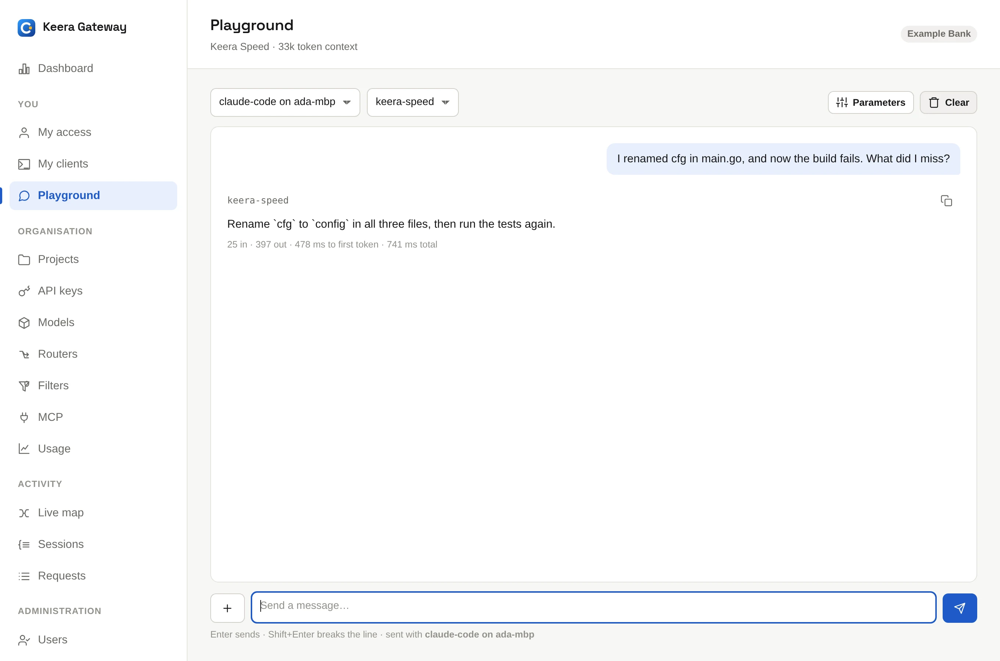

# Playground

The **Playground** lets you chat with a model in the browser. Use it to try a
model before you connect a tool, or to check that your key works.

{ .screenshot }

1. Open **Playground** in the sidebar.
2. Pick one of your active keys and a model.
3. Type a message.

Every message is sent with the key you picked, like any other request. So it
counts against that key's budget and rate limits, passes its filters and shows
up in its usage. Nothing gets around the guardrails here.

**Parameters** sets a system prompt, the temperature and the maximum length of
the answer. You can attach an image to a message, if the model reads images.
**Clear** starts a new conversation.

For everyday chats you can come back to, use [Keera Chat](chat.md).
