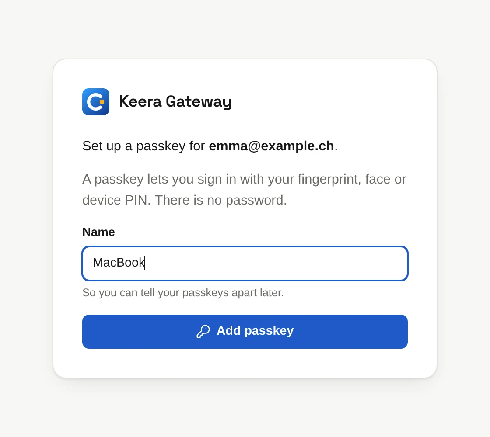

# Sign in

## In the browser

Open <https://gateway.keera.ch>. The sign-in screen shows one button for each
way to sign in, such as Google.

The first time, you either create an organisation or join one that invited
you; see the [Quickstart](../get-started/quickstart.md#1-sign-in).

If your administrator gave you a **passkey set-up link**, open it, give the
passkey a name and click **Add passkey**. Your device then asks for your
fingerprint, face or PIN. After that, sign in with **Sign in with a passkey**.

{ .screenshot width="420" }

!!! tip "Add a passkey on each device"

    Once signed in with a passkey, open the **account menu**, with your name
    at the bottom of the sidebar, and choose **Your passkeys** to add one for
    another device.

### Several organisations

If you belong to more than one organisation, the top right of the panel shows
a menu instead of the organisation's name. Pick an organisation there to
switch. Invitations to other organisations show up in the same menu.

## In the terminal

Download `keera` for Linux, macOS or Windows from the
[releases page](https://github.com/bespinian/keera-gateway/releases) and put
it on your `PATH`. It signs you in through the browser:

```sh
keera login
```

A browser window opens. Sign in as usual, and the terminal is signed in too.
Where there are several ways to sign in, add `--provider`, such as
`--provider passkey`.

| Command                   | What it does                               |
| ------------------------- | ------------------------------------------ |
| `keera whoami`            | shows who you are signed in as, and where  |
| `keera logout`            | signs this machine out                     |
| `keera logout --all`      | ends all your sign-ins, on every machine   |
| `keera org list`          | lists your organisations                   |
| `keera org switch <name>` | makes commands act on another organisation |

A sign-in lasts 30 days, in the browser and in the terminal.

!!! note "Working over ssh"

    `keera login` waits for the browser on the same machine. Over ssh, run
    `keera login --no-browser`, forward the port in the `cli_redirect` part of
    the address it prints with `ssh -L`, and open that address in your own
    browser. Or sign in on your own machine.
