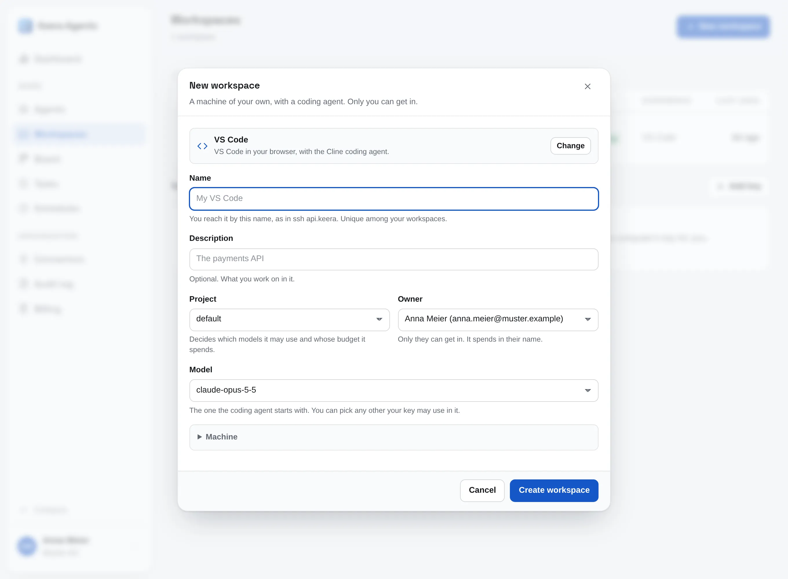

# Workspaces

A **workspace** is a machine of your own in [Keera Agents](agents.md), with a
coding agent. You work in it from your browser, or over SSH from your editor.
Only you get in.

Its coding agent uses the models your key may use, and every call goes
through Keera Gateway with a key in your name. So your guardrails, budgets and
filters apply. The key never enters the workspace, so it cannot be copied out.

## Create a workspace

In Keera Agents, open **Workspaces** and click **New workspace**. Choose what
it opens in:

- **Terminal**: pi, the coding agent, in a terminal in your browser.
- **VS Code**: VS Code in your browser, with the Cline coding agent.

Then give it a name, the model the coding agent starts with, and its machine.
Both coding agents come set up with that model. You can change the
experience later; your files stay.

{ .screenshot }

Or, with the [`keera` CLI](../reference/cli/commands.md#keera-workspace):

```sh
keera workspace create api --vscode
```

An administrator can create a workspace for someone else, such as a new
colleague. It is theirs from the start.

## Get in

**Connect** on the workspace's page shows these commands with its name filled
in:

```sh
keera workspace open api           # in your browser, until Ctrl+C
keera workspace forward api 3000   # a port in it, such as a dev server
keera workspace configure-ssh      # once per computer
ssh api.keera                      # ssh, scp, VS Code Remote-SSH, JetBrains
```

Each connection goes through Keera Agents with your `keera login`. Nothing
else reaches the workspace. In the terminal experience, `ssh` joins the same
pi session the browser shows.

Your home folder is in the workspace's disk, so tools you install with
`npm install -g` or `pip` stay. VS Code opens `~/Projects`.

## Connect it to a service

On the workspace's **Connectors** tab, add a folder, repository or service, as
for an [agent](../manage/connectors.md#connect-an-agent). Its tools act for
you. Git pushes through a connector only to branches that start with `keera/`.
To push in your own name, add your own credentials in the workspace.

## Sleep, stop and delete

- A workspace nobody is connected to goes to sleep after two hours. Programs
  in it stop, but its files stay. Connecting wakes it.
- **Stop** stops its machine and keeps its files. **Start** runs it again.
- **Delete workspace**, in **Settings**, deletes its machine and every file in
  it, and revokes its key.

Its disk [costs](../manage/billing.md#agents-and-workspaces) while it exists,
stopped too. `keera workspace cost api` shows what it cost this month.

Administrators see, stop and delete every workspace in the organisation, but
cannot get in. Other members do not see it.
